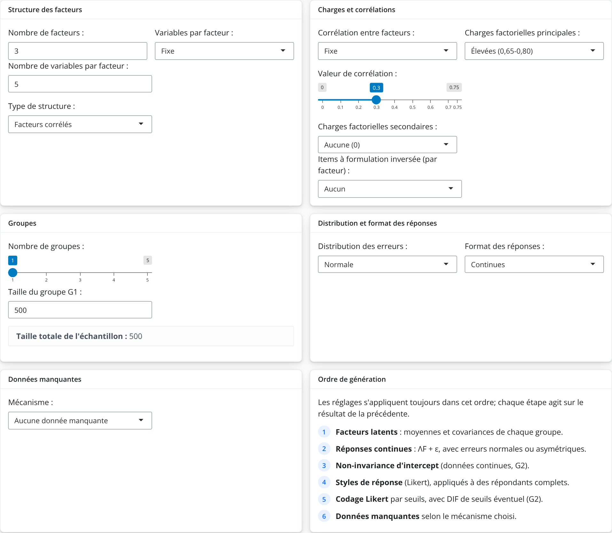
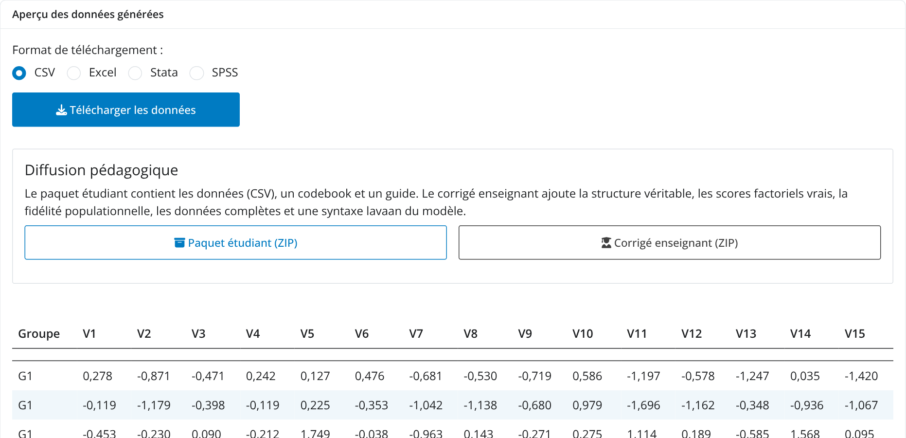
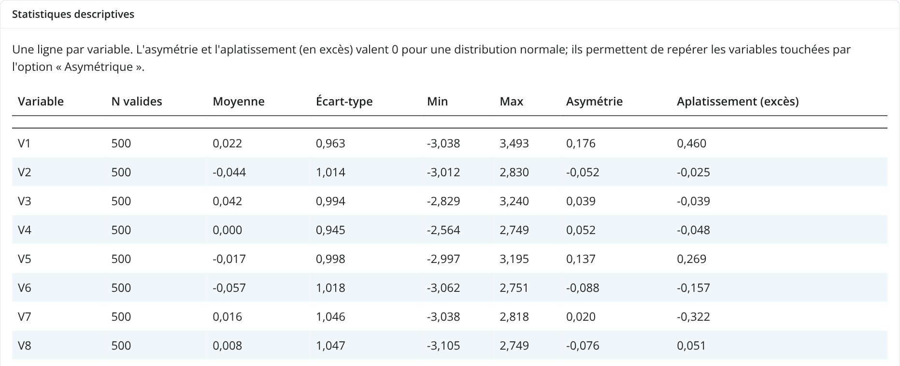
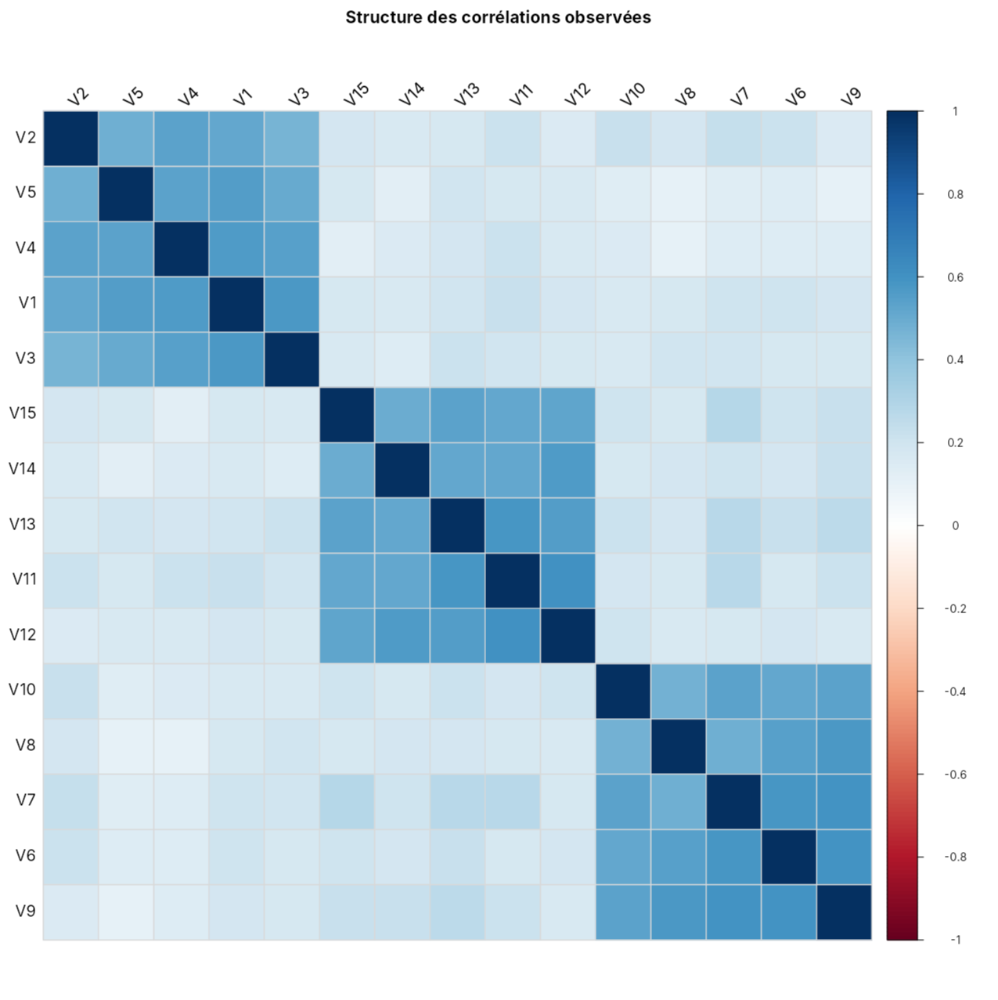
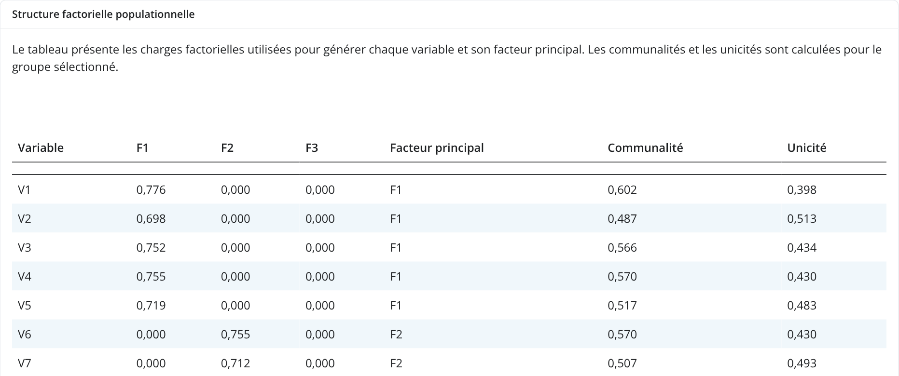
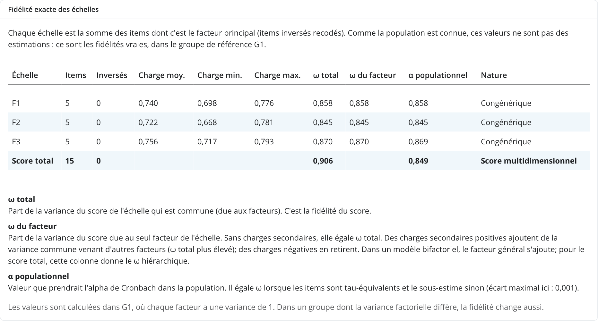
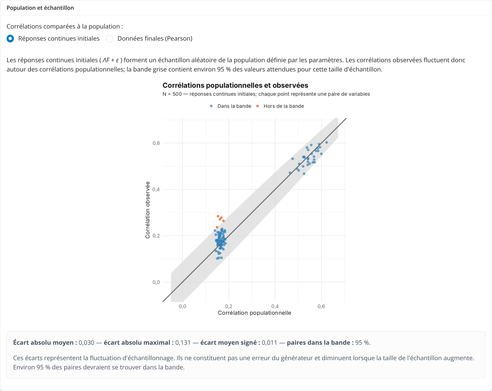

# Utiliser MultvarGen {#sec-application}

```{r}
#| include: false
source("_common.R")
rel_fil <- population_reliability(fil)
```

::: {.callout-tip title="Objectifs d'apprentissage"}
À la fin de ce chapitre, vous devriez être capable de :

- décrire l'organisation générale de l'interface : préréglages et génération, cartes de réglages, onglets de résultats;
- expliquer ce que fait chacune des six cartes de l'onglet **Configurer**;
- distinguer les sous-onglets de **Données**, de **Structure populationnelle** et de **Vérification**, et savoir où trouver une information donnée;
- expliquer la différence entre modifier un réglage, générer une nouvelle population et tirer un nouvel échantillon de la même population;
- choisir entre exporter les données, la matrice de corrélations, le paquet étudiant ou le corrigé enseignant.
:::

::: {.callout-note title="Accéder à MultvarGen"}
**MultvarGen** est accessible en ligne à l'adresse suivante :

[Ouvrir MultvarGen](https://shiny.dcstats.org/MultvarGen){.btn .btn-primary target="_blank"}
:::

::: {.callout-important title="Idée centrale"}
L'interface ne fait qu'exposer, sous forme de contrôles, les paramètres du modèle factoriel présenté au chapitre précédent. Chaque carte de l'onglet **Configurer** correspond à un ou plusieurs éléments de $\boldsymbol{\Lambda}$, $\boldsymbol{\Phi}$, $\boldsymbol{\Theta}$, des moyennes factorielles ou des transformations de réponse. Comprendre cette correspondance permet de naviguer dans l'application à partir de la théorie plutôt que de mémoriser la position des contrôles.
:::

::: {.callout-warning title="Pièges classiques"}
- Modifier un contrôle dans l'onglet **Configurer** puis examiner un onglet de résultats sans avoir recliqué sur **Générer les données** : les onglets affichent toujours le dernier jeu généré, jamais un aperçu des réglages actuels.
- Confondre les statistiques de **Description globale** (toutes les observations réunies) avec celles de **Description par groupe** : la corrélation globale peut différer sensiblement des corrélations intragroupes lorsque les groupes ont des moyennes différentes.
- Croire qu'une nouvelle graine ne change que l'échantillon : lorsque les charges ou les corrélations sont tirées dans une plage, elle change aussi la **population**. Pour un nouvel échantillon de la même population, il faut utiliser le bouton **Nouvel échantillon, même population**.
- Oublier qu'un préréglage remplace tous les réglages (sauf les groupes), y compris le format des réponses et les données manquantes choisis auparavant.
- Distribuer le **corrigé enseignant** à la place du **paquet étudiant** : le premier révèle la structure vraie, les items touchés par le DIF, le mécanisme des données manquantes et les répondants qui présentent un style de réponse.
:::

Le générateur rassemble dans une même interface les réglages nécessaires pour définir une population multivariée, produire un échantillon, l'examiner et l'exporter. Le fonctionnement général tient en une phrase : **définir la population, générer un échantillon, l'examiner, puis l'exporter**.

L'application comporte cinq onglets principaux : **Introduction**, **Configurer**, **Données**, **Structure populationnelle** et **Vérification**. À l'ouverture, un premier jeu de données est généré automatiquement avec les réglages par défaut, de sorte que tous les onglets sont immédiatement consultables.

## L'onglet Configurer

L'onglet **Configurer** commence par une carte **Préréglages et génération**, suivie de six cartes de réglages disposées sur deux colonnes.

{#fig-cap-configurer-haut .capture width="100%"}

### Les préréglages

Les **préréglages** fournissent des configurations de départ correspondant à quelques structures courantes. Un clic sur une carte remplace d'un coup tous les réglages de l'onglet, **à l'exception des groupes**; il reste ensuite à cliquer sur **Générer les données**.

| Préréglage | Population produite |
|---|---|
| Personnalité | 5 facteurs corrélés à 0,30, 5 items par facteur, charges moyennes, faibles charges secondaires |
| Tests cognitifs | 3 aptitudes corrélées à 0,40, 6 épreuves par aptitude, charges élevées, structure simple |
| Échelles d'attitudes | 4 facteurs corrélés à 0,25, 5 à 15 items, erreurs asymétriques, charges secondaires marquées |
| Performance académique | 2 facteurs corrélés à 0,50, 8 items par facteur, charges élevées |
| Détresse psychologique | structure bifactorielle : un facteur général et 3 facteurs spécifiques de 6 items |
| Sondage Likert | 4 échelles de 6 items en 7 points, un tiers d'items inversés, 15 % d'acquiescement, 10 % de données manquantes MAR |

: Les six préréglages de l'onglet **Configurer**. {#tbl-prereglages}

::: {.callout-tip title="Un point de départ, pas un modèle imposé"}
Un préréglage ne constitue pas une catégorie particulière de données. C'est une combinaison de réglages proposée comme point de départ; chacun peut ensuite être modifié.
:::

### Générer les données, tirer un nouvel échantillon

Deux boutons produisent des données, et il est important de comprendre ce qui les distingue.

**Générer les données** construit une population à partir des réglages affichés, puis en tire un échantillon. Beaucoup de réglages sont des **plages** : des charges « élevées » sont tirées entre 0,65 et 0,80, des corrélations « aléatoires » entre 0 et 0,50, le nombre d'items peut être tiré entre 5 et 15… Ces tirages font partie de la population. Le champ **Graine aléatoire (seed)** fixe l'état du générateur de nombres pseudo-aléatoires :

- si le champ contient un entier, par exemple `2024`, les mêmes réglages et la même graine reproduisent exactement la même population et le même échantillon;
- si le champ est vide, l'application tire elle-même une graine au hasard, ce qui produit en général **une autre population** (d'autres charges) et un autre échantillon.

**Nouvel échantillon, même population** conserve tout ce qui définit la population du dernier jeu généré — charges, corrélations, seuils Likert, variables asymétriques, item touché par le DIF, variable auxiliaire MAR — et tire seulement de nouvelles personnes. On peut en profiter pour changer la taille des groupes. C'est le bouton à utiliser pour observer la fluctuation d'échantillonnage. L'application inscrit alors deux graines dans les champs : celle de la population et celle de l'échantillon; avec ces deux valeurs, **Générer les données** reproduit exactement le même échantillon.

La ou les graines utilisées sont toujours affichées dans le bandeau vert sous les boutons, avec un résumé du jeu produit (taille, nombre de variables et de facteurs, groupes, format, taux de données manquantes). Une génération « au hasard » reste donc reproductible : il suffit de recopier la graine affichée.

Modifier un contrôle ne remplace pas le jeu de données examiné. Les onglets de résultats sont mis à jour seulement lorsque l'on clique sur l'un des deux boutons.

::: {.callout-note title="Quand une nouvelle graine ne change-t-elle que l'échantillon?"}
Si **tous** les réglages de structure sont fixes — nombre d'items fixe, charges principales fixes, corrélation entre facteurs fixe, aucune charge secondaire (ou une valeur fixe), réponses continues normales —, la population ne contient plus aucun tirage aléatoire. Changer la graine ne change alors que l'échantillon. Dans tous les autres cas, utilisez **Nouvel échantillon, même population**.
:::

## Les six cartes de réglages

{#fig-cap-configurer-cartes .capture width="100%"}

### Structure des facteurs

Cette carte détermine l'organisation générale des variables.

- **Nombre de facteurs** : de 1 à 10 dimensions latentes.
- **Variables par facteur** : un nombre fixe (de 2 à 30) ou un nombre tiré au hasard pour chaque facteur, entre 5 et 10, entre 5 et 15, entre 5 et 20 ou dans un intervalle personnalisé. Une structure comportant très peu d'indicateurs par facteur est plus difficile à récupérer qu'une structure comprenant plusieurs bons indicateurs.
- **Type de structure** : **facteurs corrélés** ou **bifactorielle**. Dans le second cas, un facteur général `FG` s'ajoute aux facteurs spécifiques et charge sur tous les items; le niveau de ces **charges générales** se règle dans la même carte (faibles, moyennes, élevées ou une valeur fixe). Les facteurs d'un modèle bifactoriel sont orthogonaux.

### Charges et corrélations

Cette carte règle $\boldsymbol{\Lambda}$ et $\boldsymbol{\Phi}$.

- **Corrélation entre facteurs** : une valeur fixe commune à toutes les paires (de 0 à 0,75) ou des corrélations tirées au hasard entre 0 et 0,50. Ce contrôle disparaît en structure bifactorielle.
- **Charges factorielles principales** : faibles (0,35 à 0,50), moyennes (0,50 à 0,65), élevées (0,65 à 0,80), aléatoires (0,35 à 0,80) ou fixes. Une plage produit des charges différentes d'un item à l'autre; une valeur fixe donne la même charge à tous.
- **Charges factorielles secondaires** : aucune, faibles (−0,10 à 0,10), élevées (0,10 à 0,20 en valeur absolue), aléatoires (−0,20 à 0,20) ou fixes. La **proportion** (25 %, 50 %, 75 % ou 100 %) indique la part des charges secondaires possibles qui sont effectivement non nulles. Amplitude et proportion ne jouent pas le même rôle : on peut produire quelques charges secondaires marquées ou beaucoup de charges secondaires faibles.
- **Items à formulation inversée** : aucun, environ 20 %, environ un tiers ou environ la moitié des items de chaque facteur reçoivent des charges négatives.

::: {.callout-tip title="Ne pas confondre deux types de corrélations"}
Les corrélations entre **facteurs latents** sont des paramètres de la population. Les corrélations entre **variables observées** en découlent, combinées aux charges et aux composantes propres.
:::

### Groupes

Le générateur peut produire de un à cinq groupes, identifiés par `G1`, `G2`, etc. La taille de chaque groupe se saisit séparément (au moins 10 personnes), et la carte affiche l'effectif total $N = \sum_g n_g$. Lorsque plusieurs groupes sont demandés, trois contrôles apparaissent :

- **Différences de moyennes latentes** : aucune, faibles (0,25), modérées (0,50) ou fortes (0,80), en unités d'écart-type du facteur. `G1` sert de référence; `G2` est déplacé sur le premier facteur, `G3` sur le deuxième, et ainsi de suite.
- **Covariances entre groupes** : identiques, variations modérées ou fortes. Les variations modifient certaines corrélations entre facteurs et la variance d'un facteur par groupe.
- **Invariance de mesure** : la condition de référence, ou une violation ciblée pour un item de `G2` — un **DIF d'intercept** de 0,60 pour des réponses continues, un **DIF de seuils** de 0,60 pour des réponses Likert.

::: {.callout-note title="Ce qui demeure commun aux groupes"}
Les groupes partagent la même structure de mesure : mêmes charges, mêmes variances propres et, par défaut, mêmes intercepts et mêmes seuils Likert. Seules les distributions latentes (moyennes et covariances) diffèrent, sauf lorsqu'une violation d'invariance est explicitement demandée.
:::

### Distribution et format des réponses

- **Distribution des erreurs** : normale ou asymétrique. Dans le second cas, le **degré d'asymétrie** (faible, modéré, fort) règle à la fois l'intensité de l'asymétrie et la proportion approximative de variables touchées; certaines restent pratiquement normales.
- **Format des réponses** : continu ou **Likert ordinal**. Pour les réponses Likert, on choisit le **nombre de catégories** (de 2 à 7), le **patron des seuils** (commun à tous les items ou varié selon l'item) et, pour un patron commun, le **profil** : équilibré, centré symétrique, surtout bas ou surtout haut.
- **Style de réponse** (Likert seulement) : tendance au milieu, tendance aux extrêmes ou acquiescement, chez 5 % à 30 % des répondants. Le style touche tous les items d'une même personne.

::: {.callout-warning title="Analyse de réponses ordinales"}
Les corrélations de l'onglet **Données** sont des corrélations de Pearson calculées sur les codes 1, 2, 3… Pour une AFE ou une AFC de réponses Likert, utilisez de préférence des corrélations polychoriques et un estimateur adapté aux variables ordinales. L'onglet **Vérification** permet de comparer les deux.
:::

### Données manquantes

Le **mécanisme** peut être MCAR (complètement au hasard), MAR (selon une variable observée qui reste complète) ou MNAR (selon la valeur manquante elle-même). La **proportion de cellules manquantes** varie de 5 % à 40 %. Un court texte sous le contrôle rappelle ce que chaque mécanisme implique pour les moyennes calculées sur les cas disponibles.

### Ordre de génération

La dernière carte ne contient aucun réglage. Elle rappelle l'ordre dans lequel les opérations s'enchaînent : facteurs latents, réponses continues, non-invariance d'intercept, styles de réponse, codage Likert (avec un DIF de seuils éventuel), puis données manquantes. Cet ordre explique, par exemple, qu'un style de réponse modifie les catégories Likert, ou que les données manquantes MNAR dépendent de la réponse continue sous-jacente.

## L'onglet Données

L'onglet **Données** montre ce qui a effectivement été généré. Un rappel du dernier jeu (taille, graine) figure en haut de l'onglet. Cinq sous-onglets se succèdent.

### Données simulées

Chaque ligne représente une observation et chaque colonne une variable; la variable `Groupe` identifie la population d'origine. L'aperçu se limite aux 100 premières observations, mais les fichiers téléchargés contiennent le jeu complet.

{#fig-cap-donnees .capture width="92%"}

Trois exportations sont proposées.

- **Télécharger les données** : CSV, Excel, Stata (`.dta`) ou SPSS (`.sav`). Les valeurs manquantes sont laissées vides en CSV et en Excel, et codées comme manquantes en Stata et en SPSS.
- **Paquet étudiant (ZIP)** : les données en CSV, un codebook (avec le sens de formulation des items s'il y a des items inversés) et un guide. Il ne révèle ni la structure vraie, ni le mécanisme des données manquantes, ni les styles de réponse, ni le DIF.
- **Corrigé enseignant (ZIP)** : le contenu du paquet étudiant, plus la structure vraie (charges, sens, communalités, seuils Likert), les moyennes et matrices latentes par groupe, la fidélité populationnelle de chaque échelle, la matrice de corrélations de la population, les scores factoriels vrais de chaque personne, une syntaxe `lavaan` du modèle et un fichier lisez-moi qui consigne tous les réglages et la graine. Selon le cas s'ajoutent les données complètes avant suppression des valeurs manquantes, les réponses continues avant le codage Likert, l'item touché par le DIF et la liste des répondants présentant un style de réponse.

### Description globale

Le premier tableau donne, pour chaque variable, le nombre de valeurs valides, le pourcentage manquant (s'il y a lieu), la moyenne, l'écart-type, le minimum, le maximum, l'asymétrie et l'aplatissement en excès. Ces deux derniers indices valent 0 pour une distribution normale : ils permettent de repérer les variables touchées par l'option asymétrique.

{#fig-cap-descriptives .capture width="92%"}

La **matrice de corrélations observées** suit, sous forme graphique ou numérique. La représentation graphique réordonne les variables par classification hiérarchique, ce qui fait ressortir les blocs; le tableau donne les valeurs exactes. La matrice peut être exportée en CSV, en Excel, en fichier `.do` pour Stata (matrice pour `factormat`/`pcamat` et données SSD pour `sem`) ou en fichier matriciel SPSS.

{#fig-cap-correlations .capture width="70%"}

Dans une simulation multigroupe, ces statistiques sont calculées sur **l'ensemble des observations réunies**. Lorsqu'il existe des données manquantes, chaque corrélation utilise les observations disponibles pour la paire de variables concernée : l'effectif peut donc varier d'une paire à l'autre.

### Description par groupe

Lorsque plusieurs groupes ont été générés, ce sous-onglet présente les moyennes de chaque groupe, puis la matrice de corrélations ou de covariances du groupe choisi. La distinction entre les deux est utile lorsque les groupes ont des variances différentes : deux groupes peuvent présenter des corrélations semblables avec des covariances différentes.

### Distributions

Ce sous-onglet trace jusqu'à 20 variables à la fois, choisies dans une liste. Pour des réponses continues, on peut afficher des histogrammes, des boîtes à moustaches, des courbes de densité ou des graphiques quantile-quantile; pour des réponses Likert, des diagrammes en barres des fréquences de chaque catégorie. Les items inversés sont signalés dans le titre de leur graphique. Ces graphiques ne constituent pas des tests formels : ils servent à comprendre les données qui viennent d'être générées.

### Données manquantes

Lorsque des données manquantes ont été demandées, ce sous-onglet en mesure les conséquences : taux obtenu, nombre de cas complets, comparaison des moyennes calculées sur les cas disponibles avec les moyennes des données complètes, taux par groupe et aperçu du patron des cellules vides. Le chapitre 10 y revient en détail.

## L'onglet Structure populationnelle

Cet onglet décrit non pas l'échantillon, mais **la population utilisée pour le produire** : c'est le corrigé de toute analyse ultérieure. Il comporte trois sous-onglets.

### Structure des variables

La matrice des charges utilisées pour produire les données, avec, pour chaque variable, son facteur principal, son sens (direct ou inversé, s'il y a des items inversés), sa communalité et son unicité. Pour des réponses Likert, le profil et les seuils de chaque item s'ajoutent. Dans une simulation multigroupe, on choisit le groupe pour lequel les communalités sont calculées : les charges sont communes, mais la part de variance commune change si les variances factorielles diffèrent. Des encadrés signalent, s'il y a lieu, la structure bifactorielle, les items inversés, l'item touché par le DIF et le style de réponse introduit.

{#fig-cap-structure-variables .capture width="92%"}

### Structure des facteurs

Le tableau des moyennes latentes de chaque groupe (`G1` vaut 0 par définition), puis la matrice de corrélations ou de covariances factorielles du groupe choisi.

### Fidélité populationnelle

Pour chaque échelle — la somme des items dont c'est le facteur principal, items inversés recodés —, ce sous-onglet donne la fidélité **exacte** dans la population : ω total, ω attribuable au seul facteur de l'échelle et valeur que prendrait l'alpha de Cronbach. Il indique aussi la nature des items (parallèles, congénériques, bifactoriels) et, pour une structure bifactorielle, le ω hiérarchique et la part de variance commune expliquée par le facteur général. Le chapitre 5 explique ces indices.

{#fig-cap-fidelite .capture width="92%"}

## L'onglet Vérification

L'onglet **Vérification** compare la population à l'échantillon. Chaque point du graphique représente une paire de variables : sa corrélation populationnelle en abscisse, sa corrélation observée en ordonnée. Si l'échantillon reproduisait parfaitement la population, tous les points seraient sur la diagonale. En pratique, ils se répartissent autour d'elle en raison de la fluctuation d'échantillonnage; la **bande grise** indique la zone où l'on attend environ 95 % des points pour la taille d'échantillon utilisée.

{#fig-cap-verification .capture width="92%"}

Un sélecteur permet de choisir les corrélations comparées à la population :

- **réponses continues initiales**, avant toute transformation : le graphique isole alors la seule fluctuation d'échantillonnage;
- **données finales (Pearson)**, c'est-à-dire les données téléchargées : le graphique montre en plus l'effet du DIF, du style de réponse, du codage Likert et des données manquantes;
- **données finales (polychoriques)**, pour des réponses Likert : ces corrélations estiment les corrélations continues sous-jacentes à partir des seules catégories.

Quatre résumés accompagnent le graphique : l'**écart absolu moyen**, l'**écart absolu maximal**, l'**écart moyen signé** (négatif lorsque les corrélations observées sont systématiquement atténuées) et le **pourcentage de paires dans la bande**. Le chapitre 3 explique comment les lire.

::: {.callout-tip title="Une expérience très simple"}
Générez une population, puis cliquez plusieurs fois sur **Nouvel échantillon, même population**. La population ne change pas, mais les points du graphique se déplacent d'un tirage à l'autre. Augmentez ensuite fortement la taille du groupe avant de tirer un nouvel échantillon : la bande se resserre et les points se concentrent autour de la diagonale.
:::

::: {.callout-note title="🖥️ Dans l'application"}
- **Reproduire le fil rouge** : 3 facteurs, Fixe — 5 variables, corrélation Fixe — 0,30, charges principales Élevées, charges secondaires Aucune, 1 groupe de 500, graine `2024`, **Générer les données**.
- **Retrouver une graine** : le bandeau vert sous les boutons (onglet **Configurer**) et le rappel en haut de l'onglet **Données**.
- **Observer la fluctuation d'échantillonnage** : **Nouvel échantillon, même population**, plusieurs fois de suite.
- **Préparer un exercice** : fixer une graine, générer, télécharger le **paquet étudiant** pour la classe et garder le **corrigé enseignant** pour soi.
:::

## Laboratoire : se repérer dans l'interface {#sec-labo-2}

Reproduisez la population fil rouge (graine 2024), puis répondez aux questions en indiquant chaque fois l'onglet consulté.

1. Quelle est la charge de `V1` sur son facteur? Quelle est sa communalité?
2. Quelle est la fidélité (ω total) de l'échelle formée par `V1` à `V5`?
3. Quelle est l'asymétrie observée de `V1`? Est-elle compatible avec une distribution normale?
4. Combien de paires de variables se trouvent dans la bande grise de l'onglet **Vérification**?

::: {.callout-tip title="Réponse" collapse="true"}
1. **Structure populationnelle → Structure des variables** : $\lambda_{11} = `r frm(fil$loadings[1, 1])`$ et $h^2_1 = `r frm(fil$communalities[1])`$, soit le carré de la charge, puisque `V1` n'a aucune charge secondaire.
2. **Structure populationnelle → Fidélité populationnelle** : ω total = `r fr(rel_fil[1, "ω total"], 3)` pour F1.
3. **Données → Description globale** : l'asymétrie de `V1` vaut `r fr(describe_variables(fil$response)$Asymétrie[1], 3)`, une valeur très proche de 0, comme on l'attend d'une variable normale.
4. **Vérification** (réponses continues initiales) : `r pc(mean(abs(fil_e$ecart) <= 1.96 * (1 - fil_e$rho^2) / sqrt(500)), 0)` des `r nrow(fil_e)` paires, soit à peu près les 95 % attendus.
:::

::: {.callout-important title="À retenir"}
- Le parcours de base : **Configurer → Générer les données → Données → Structure populationnelle → Vérification → exporter**.
- Un réglage modifié n'a aucun effet tant qu'on n'a pas généré de nouveau.
- **Générer les données** peut changer la population; **Nouvel échantillon, même population** ne change que les personnes.
- La ou les graines utilisées sont toujours affichées; elles rendent chaque jeu reproductible.
- **Structure populationnelle** est le corrigé; **Vérification** mesure l'écart entre ce corrigé et l'échantillon.
- Le paquet étudiant cache la structure vraie; le corrigé enseignant la révèle.
:::

## Un parcours simple à retenir

Malgré le nombre de réglages, l'utilisation du générateur se résume à quelques opérations :

1. définir la structure factorielle;
2. définir les groupes et leur taille;
3. choisir la distribution, le format des réponses et, s'il y a lieu, les données manquantes;
4. régler les corrélations et les charges;
5. générer les données et noter la graine;
6. examiner les données et la population;
7. vérifier la correspondance entre population et échantillon;
8. exporter les données pour l'analyse.

Il n'est pas nécessaire de modifier tous les réglages à chaque simulation. Pour comprendre l'effet d'une caractéristique, il est préférable de **modifier une propriété importante de la population tout en maintenant les autres stables**.

Le chapitre suivant examine de plus près la relation entre population et échantillon : pourquoi deux échantillons tirés d'une même population ne donnent jamais exactement les mêmes moyennes, variances ou corrélations, et comment la taille de l'échantillon détermine l'ampleur de ces fluctuations.

## Erreurs fréquentes

| Erreur | Ce qu'il faut retenir |
|---|---|
| Modifier un réglage puis lire les onglets de résultats sans générer de nouveau | Les onglets affichent toujours le dernier jeu généré, jamais les réglages affichés |
| Confondre Description globale et Description par groupe | La première réunit toutes les observations; la seconde sépare les groupes — les corrélations peuvent différer nettement |
| Vider la graine pour étudier la fluctuation d'échantillonnage | Une nouvelle graine change aussi les charges tirées dans une plage; le bouton **Nouvel échantillon, même population** garde la population |
| Appliquer un préréglage en croyant conserver ses propres réglages | Un préréglage remplace tous les réglages, sauf les groupes |
| Chercher les corrélations entre variables observées dans la carte « Charges et corrélations » | Cette carte définit les corrélations entre **facteurs**; les corrélations entre variables se lisent dans **Données → Description globale** |
| Distribuer le corrigé enseignant | Seul le paquet étudiant est destiné à la classe |

## Quiz

::: {.callout-note title="Question 1 — vrai ou faux" collapse="true"}
Vrai ou faux : lorsque le champ de la graine est vide, il est impossible de reproduire exactement le jeu de données obtenu.

**Réponse : Faux.** L'application tire alors une graine au hasard et l'affiche dans le bandeau vert. Il suffit de la recopier dans le champ pour reproduire le même jeu.
:::

::: {.callout-note title="Question 1 bis — vrai ou faux" collapse="true"}
Vrai ou faux : avec des charges principales « Élevées », vider la graine et cliquer deux fois sur **Générer les données** produit deux échantillons de la même population.

**Réponse : Faux.** Les charges « élevées » sont tirées entre 0,65 et 0,80; une nouvelle graine produit d'autres charges, donc une autre population. Pour deux échantillons de la même population, il faut **Nouvel échantillon, même population**.
:::

::: {.callout-note title="Question 2 — numérique" collapse="true"}
Vous générez trois groupes de 150, 200 et 250 personnes, avec 4 facteurs de 6 items. Combien de lignes et de colonnes contient le fichier CSV téléchargé?

**Réponse : 600 lignes de données et 25 colonnes** : 24 items plus la variable `Groupe`.
:::

::: {.callout-note title="Question 3 — où regarder?" collapse="true"}
Vous voulez savoir si l'item `V7` est inversé, quelle est sa charge et quelle est la fidélité de son échelle. Quels sous-onglets consultez-vous?

**Réponse :** **Structure populationnelle → Structure des variables** pour le sens et la charge de `V7`; **Structure populationnelle → Fidélité populationnelle** pour la fidélité de l'échelle.
:::

::: {.callout-note title="Question 4 — diagnostic de scénario" collapse="true"}
Après avoir appliqué le préréglage **Sondage Likert**, une étudiante remarque, dans **Description globale**, des corrélations négatives entre certains items d'une même échelle. Elle conclut que le générateur s'est trompé. Que lui répondez-vous?

**Réponse :** Ce préréglage inverse environ un tiers des items de chaque échelle. Un item inversé corrèle négativement avec les items directs de son échelle tant qu'il n'est pas recodé. La colonne **Sens** de **Structure des variables** (et le codebook du paquet étudiant) indique lesquels recoder avant de calculer un score ou un alpha.
:::
