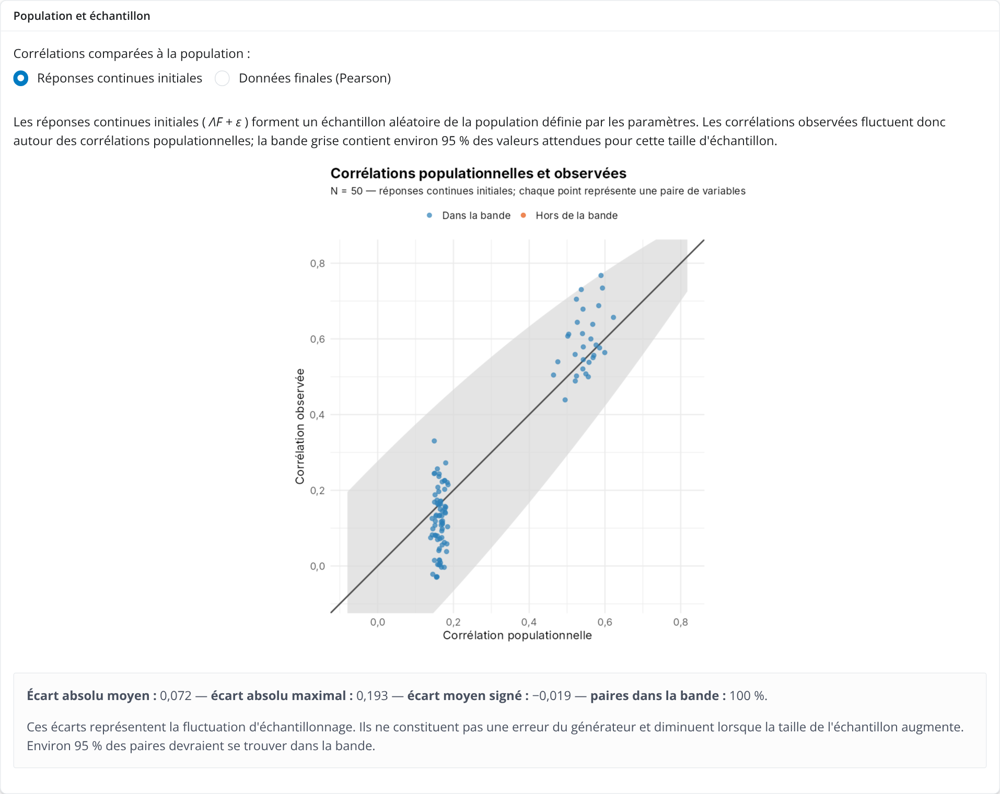

# Population et échantillon {#sec-population}

```{r}
#| include: false
source("_common.R")
bande <- function(e, n) mean(abs(e$ecart) <= 1.96 * (1 - e$rho^2) / sqrt(n))
tailles <- c(50L, 500L, 2000L)
res_n <- lapply(tailles, function(n) { d <- generer(2024, group_sizes = n); e <- ecarts(d)
  c(moy = mean(abs(e$ecart)), max = max(abs(e$ecart)), signe = mean(e$ecart), bande = bande(e, n)) })
names(res_n) <- tailles
```

::: {.callout-tip title="Objectifs d'apprentissage"}
À la fin de ce chapitre, vous devriez être capable de :

- expliquer pourquoi une statistique calculée dans un échantillon diffère presque toujours du paramètre populationnel correspondant;
- relier l'ampleur de la fluctuation d'échantillonnage à la taille de l'échantillon, notamment par l'erreur-type;
- interpréter le graphique de l'onglet **Vérification**, sa bande de fluctuation et les quatre résumés numériques qui l'accompagnent;
- choisir la source de comparaison (réponses continues initiales, données finales, corrélations polychoriques) selon la question posée;
- distinguer trois opérations : reproduire un jeu (même graine), créer une nouvelle population (nouvelle graine) et tirer un nouvel échantillon de la même population;
- écrire et interpréter les formules de la moyenne et de la covariance d'une population résultant du mélange de plusieurs groupes.
:::

::: {.callout-important title="Idée centrale"}
Parce que le générateur connaît exactement la population, il permet de voir directement — plutôt que d'inférer — ce que produit la fluctuation d'échantillonnage. Un écart entre une statistique observée et le paramètre théorique correspondant n'est donc pas une erreur : c'est la conséquence normale du tirage aléatoire, et son ampleur diminue à mesure que la taille de l'échantillon augmente.
:::

::: {.callout-warning title="Pièges classiques"}
- Croire qu'un écart entre corrélation observée et corrélation populationnelle indique un problème avec le générateur ou avec les paramètres choisis : c'est exactement le phénomène que ce chapitre explique.
- Interpréter l'écart absolu **maximal** comme une mesure de la qualité générale de la simulation, alors qu'il ne signale qu'une seule paire de variables particulièrement fluctuante — parfaitement normal dans une matrice comportant plusieurs variables.
- Conclure d'un seul échantillon qu'une taille $N$ « suffit » : deux échantillons de même taille peuvent reproduire la population très différemment.
- Croire que la population globale d'une simulation multigroupe correspond simplement à la matrice de covariance d'un des groupes : elle combine la variabilité à l'intérieur des groupes **et** la variabilité entre leurs moyennes.
- Croire qu'une nouvelle graine ne change que l'échantillon : lorsque des réglages sont des plages (charges « élevées », corrélations « aléatoires »…), la graine détermine aussi les valeurs tirées pour la population.
- Confondre l'erreur-type, qui décrit la variabilité d'une statistique d'un échantillon à l'autre, avec l'écart-type, qui décrit la dispersion des observations individuelles à l'intérieur d'un même échantillon.
:::

Le générateur possède une caractéristique particulièrement utile pour l'apprentissage : il permet de connaître la population avant même de tirer un échantillon.

Dans les données réelles, la situation est habituellement inverse. Nous observons un échantillon et nous essayons d'inférer les propriétés d'une population inconnue. En simulation, nous pouvons définir explicitement cette population, générer des observations à partir d'elle, puis comparer ce que nous avions spécifié à ce que nous retrouvons dans les données.

Cette possibilité permet d'observer directement la **fluctuation d'échantillonnage**.

## Deux objets à ne pas confondre

Supposons que la population possède une matrice de corrélations donnée par :

$$
\boldsymbol{\Sigma}.
$$

Après avoir généré un échantillon de taille $N$, nous pouvons calculer sa matrice de corrélations observées :

$$
\mathbf{R}.
$$

Même si l'échantillon provient exactement de la population définie par le générateur, les deux matrices ne seront généralement pas identiques.

La population pourrait, par exemple, comporter une corrélation :

$$
\rho_{12}=0{,}50,
$$

alors qu'un échantillon particulier donne :

$$
r_{12}=0{,}46.
$$

Un autre échantillon tiré de la même population pourrait donner :

$$
r_{12}=0{,}54.
$$

Ces écarts sont normaux. Ils proviennent du caractère aléatoire de l'échantillonnage.

## La fluctuation d'échantillonnage

Une statistique calculée dans un échantillon est une variable aléatoire.

Si l'on tire plusieurs échantillons indépendants dans une même population, leurs moyennes, variances, covariances et corrélations ne seront pas exactement les mêmes.

Pour une moyenne, on peut écrire :

$$
\bar{X} \neq \mu
$$

dans un échantillon particulier, même lorsque celui-ci provient parfaitement d'une population de moyenne $\mu$.

De même :

$$
s^2 \neq \sigma^2
$$

et :

$$
r_{jk} \neq \rho_{jk}.
$$

Les statistiques observées fluctuent autour des valeurs populationnelles.

::: {.callout-note title="Une différence n'est pas nécessairement une erreur"}
Lorsque la corrélation observée diffère légèrement de la corrélation populationnelle, cela ne signifie pas que le générateur a mal fonctionné. Cette différence est précisément ce que l'on attend d'un échantillon aléatoire.
:::

## Le rôle de la taille de l'échantillon

La taille de l'échantillon influence directement l'importance de ces fluctuations.

Avec un petit échantillon, les statistiques observées peuvent s'écarter sensiblement des valeurs populationnelles.

Avec un grand échantillon, elles ont généralement tendance à s'en rapprocher.

Cette propriété résulte de la loi des grands nombres et, plus généralement, du fait que l'incertitude d'échantillonnage diminue lorsque le nombre d'observations augmente.

Pour la moyenne, par exemple, l'erreur-type est :

$$
SE(\bar{X})
=
\frac{\sigma}{\sqrt{N}}.
$$

Lorsque $N$ augmente, l'erreur-type diminue.

Le même principe général s'applique aux corrélations. Pour des données normales, l'erreur-type approximative d'une corrélation est :

$$
SE(r) \approx \frac{1-\rho^2}{\sqrt{N}}.
$$

Elle diminue elle aussi comme $1/\sqrt{N}$, et elle est plus petite pour les corrélations fortes que pour les corrélations proches de zéro. La @fig-distribution-r montre ce phénomène pour une paire de la population fil rouge.

```{r}
#| label: fig-distribution-r
#| cache: true
#| fig-cap: "Distribution de la corrélation observée entre V1 et V2 sur 2 000 échantillons tirés de la population fil rouge (ρ = 0,54, trait vertical), pour trois tailles d'échantillon."
#| fig-height: 3.2
set.seed(31)
rho12 <- fil_S[1, 2]
sim_r <- do.call(rbind, lapply(c(50, 200, 1000), function(n) {
  r <- replicate(2000, cor(MASS::mvrnorm(n, rep(0, 15), fil_S)[, 1:2])[1, 2])
  data.frame(N = paste0("N = ", ent(n)), r = r)
}))
sim_r$N <- factor(sim_r$N, levels = paste0("N = ", ent(c(50, 200, 1000))))
ggplot(sim_r, aes(r, fill = N)) +
  geom_density(alpha = 0.45, colour = NA) +
  geom_vline(xintercept = rho12, linewidth = 0.8) +
  scale_fill_manual(values = c(pal$orange, pal$vert, pal$bleu), name = NULL) +
  scale_x_continuous(labels = axe_fr, breaks = seq(0, 1, 0.1)) +
  labs(x = "Corrélation observée entre V1 et V2", y = "Densité")
```

Avec $N = 50$, la corrélation observée se promène couramment entre `r fr(quantile(sim_r$r[sim_r$N == "N = 50"], 0.025), 2)` et `r fr(quantile(sim_r$r[sim_r$N == "N = 50"], 0.975), 2)` (95 % des échantillons); avec $N = 1\,000$, elle reste entre `r fr(quantile(sim_r$r[sim_r$N == "N = 1 000"], 0.025), 2)` et `r fr(quantile(sim_r$r[sim_r$N == "N = 1 000"], 0.975), 2)`.

## Une première expérience

Une expérience très simple permet d'observer directement ce phénomène.

Générez d'abord une population factorielle donnée avec un petit échantillon, par exemple :

$$
N=50.
$$

Examinez ensuite l'onglet **Vérification**.

Cliquez ensuite plusieurs fois sur **Nouvel échantillon, même population**. La population reste exactement la même — mêmes charges, mêmes corrélations populationnelles —, mais de nouvelles personnes sont tirées à chaque clic.

Vous constaterez que les corrélations observées peuvent varier assez sensiblement d'un échantillon à l'autre.

Répétez ensuite la même expérience avec :

$$
N=500
$$

puis, si vous le souhaitez :

$$
N=2000.
$$

Les corrélations observées devraient progressivement se concentrer davantage autour de leurs valeurs populationnelles.

::: {.callout-tip title="Changer N sans changer la population"}
Le générateur tire toujours la population (charges, corrélations, seuils…) **avant** les personnes. Deux conséquences pratiques en découlent. Avec une graine fixe, changer seulement la taille du groupe garde la même population : avec la graine 2024, la charge de `V1` vaut `r fr(fil$loadings[1, 1], 3)` quelle que soit la taille. Et le bouton **Nouvel échantillon, même population** permet aussi de changer la taille des groupes avant de tirer les nouvelles personnes.
:::

## La vérification graphique

L'onglet **Vérification** représente chaque corrélation par un point.

L'axe horizontal correspond à la corrélation populationnelle et l'axe vertical à la corrélation observée dans l'échantillon.

Pour une paire de variables $j$ et $k$, le point possède donc les coordonnées :

$$
(\rho_{jk}, r_{jk}).
$$

Si la corrélation observée était exactement égale à la corrélation populationnelle, le point serait situé sur la diagonale :

$$
r_{jk}=\rho_{jk}.
$$

L'ensemble des points devrait donc se répartir autour de cette diagonale.

Plus ils sont proches de la ligne, plus l'échantillon reproduit fidèlement la structure corrélationnelle de la population.

La **bande grise** matérialise la fluctuation attendue : pour chaque valeur de $\rho$, elle s'étend de $\rho - 1{,}96\,SE$ à $\rho + 1{,}96\,SE$, avec $SE = (1-\rho^2)/\sqrt{N}$. Environ 95 % des points devraient s'y trouver. La bande est plus large pour les petits échantillons et plus étroite pour les corrélations fortes.

{#fig-cap-verification-n50 .capture width="92%"}

### Quelles corrélations comparer?

Un sélecteur, au-dessus du graphique, détermine les corrélations comparées à la population :

- **Réponses continues initiales** : les réponses $\boldsymbol{\Lambda}\mathbf{F}+\boldsymbol{\varepsilon}$, avant toute transformation. Le graphique répond à la question « l'échantillon reproduit-il la structure factorielle construite? ». Seule la fluctuation d'échantillonnage écarte les points de la diagonale.
- **Données finales (Pearson)** : les corrélations des données téléchargées, après DIF, style de réponse, codage Likert et données manquantes. Le graphique répond alors à une autre question : « quelle distorsion les transformations ajoutent-elles à la fluctuation d'échantillonnage? ».
- **Données finales (polychoriques)**, pour des réponses Likert : des corrélations qui estiment les relations entre les réponses continues sous-jacentes à partir des seules catégories.

Pour des données continues sans aucune transformation, les deux premières sources donnent exactement le même graphique.

## Résumer les écarts

Le graphique est accompagné de quatre résumés numériques.

Pour chaque paire de variables, on peut calculer l'écart absolu :

$$
d_{jk}
=
\left|
r_{jk}-\rho_{jk}
\right|.
$$

L'écart absolu moyen est alors :

$$
\bar{d}
=
\frac{1}{m}
\sum_{j<k}
\left|
r_{jk}-\rho_{jk}
\right|,
$$

où $m$ représente le nombre de corrélations distinctes considérées.

L'écart absolu maximal correspond à :

$$
d_{\max}
=
\max_{j<k}
\left|
r_{jk}-\rho_{jk}
\right|.
$$

La première mesure résume la qualité générale de la reproduction de la matrice populationnelle. La seconde attire l'attention sur la paire de variables présentant l'écart le plus important.

Deux autres résumés complètent le tableau. L'**écart moyen signé**,

$$
\bar e = \frac{1}{m}\sum_{j<k}\left(r_{jk}-\rho_{jk}\right),
$$

reste proche de zéro lorsque les écarts sont purement aléatoires : certaines corrélations sont surestimées, d'autres sous-estimées. Il devient nettement négatif lorsque les corrélations observées sont systématiquement **atténuées**, par exemple par le codage Likert, et positif lorsqu'une source commune de variance les **gonfle**, comme un style d'acquiescement. Enfin, le **pourcentage de paires dans la bande** se compare aux 95 % attendus.

Il ne s'agit pas de tests statistiques. Ces valeurs servent à apprécier la proximité entre population et échantillon. Les corrélations d'une même matrice ne sont d'ailleurs pas indépendantes : un échantillon un peu atypique sur un facteur déplace d'un coup toutes les corrélations qui en dépendent.

```{r}
#| label: fig-ecart-n
#| cache: true
#| fig-cap: "Écart absolu moyen entre corrélations observées et populationnelles selon la taille de l'échantillon (population fil rouge, 300 échantillons par taille). La ligne relie les médianes; la zone grise contient 90 % des échantillons."
#| fig-height: 3.3
set.seed(32)
k <- lower.tri(fil_S)
ns <- c(50, 100, 200, 300, 500, 1000, 2000)
sim_e <- do.call(rbind, lapply(ns, function(n) {
  v <- replicate(300, mean(abs(cor(MASS::mvrnorm(n, rep(0, 15), fil_S))[k] - fil_S[k])))
  data.frame(N = n, med = median(v), bas = quantile(v, 0.05), haut = quantile(v, 0.95))
}))
ggplot(sim_e, aes(N, med)) +
  geom_ribbon(aes(ymin = bas, ymax = haut), fill = "grey85") +
  geom_line(colour = pal$bleu, linewidth = 1) + geom_point(colour = pal$bleu, size = 2) +
  scale_x_log10(breaks = ns, labels = function(x) ent(x)) +
  scale_y_continuous(labels = axe_fr) +
  labs(x = "Taille de l'échantillon (échelle logarithmique)", y = "Écart absolu moyen")
```

La @fig-ecart-n montre la loi générale : chaque fois que $N$ est multiplié par 4, l'écart absolu moyen est à peu près divisé par 2. Elle montre aussi la dispersion d'un échantillon à l'autre : à taille égale, certains échantillons reproduisent la population nettement moins bien que d'autres.

## Pourquoi certaines corrélations fluctuent-elles davantage ?

Toutes les corrélations observées ne s'écartent pas nécessairement de leur valeur populationnelle dans la même mesure.

Plusieurs facteurs interviennent.

La taille de l'échantillon est évidemment importante, mais la valeur de la corrélation elle-même joue aussi un rôle. Les caractéristiques distributionnelles des variables peuvent également influencer la stabilité des estimations.

Dans une structure factorielle comportant de nombreuses variables, il est donc parfaitement normal qu'une ou deux corrélations présentent un écart plus important alors que l'ensemble de la matrice est bien reproduit.

C'est pourquoi il est généralement préférable d'examiner à la fois le nuage complet et les mesures résumées plutôt que de juger la simulation à partir d'une seule paire de variables.

::: {.callout-note title="🖥️ Dans l'application"}
- **Vérification** : choisissez **Réponses continues initiales** pour isoler la fluctuation d'échantillonnage, **Données finales** pour voir l'effet des transformations.
- Lisez l'**écart moyen signé** avant l'écart absolu : un signe nettement négatif signale une atténuation systématique, pas seulement du bruit.
- Pour comparer plusieurs échantillons **d'une même population**, utilisez **Nouvel échantillon, même population**; pour comparer plusieurs tailles, changez la taille du groupe avant de cliquer, ou gardez la même graine et ne changez que la taille.
:::

## La graine aléatoire comme outil expérimental

Il faut distinguer deux niveaux de hasard dans le générateur.

Le premier concerne **la population**. Beaucoup de réglages sont des règles plutôt que des valeurs : « charges principales entre 0,65 et 0,80 », « corrélations entre facteurs tirées entre 0 et 0,50 », « 5 à 15 items par facteur ». La population effectivement construite — la matrice $\boldsymbol{\Lambda}$ précise, la matrice $\boldsymbol{\Phi}$ précise — est un tirage parmi toutes celles que ces règles permettent. Le second niveau concerne **l'échantillon** : les scores factoriels et les erreurs des personnes tirées dans cette population.

La graine fixe les deux niveaux à la fois. Trois opérations en découlent.

| Ce que l'on veut | Ce qu'il faut faire |
|---|---|
| Reproduire exactement un jeu de données | Mêmes réglages et même graine (les deux graines, le cas échéant), puis **Générer les données** |
| Une autre population obéissant aux mêmes règles | Vider la graine (ou en changer), puis **Générer les données** |
| Un autre échantillon de la même population | **Nouvel échantillon, même population** |

: Trois usages de la graine aléatoire. {#tbl-graines}

Avec la graine `2024` et les réglages du fil rouge, n'importe qui retrouve exactement les données de ce manuel. Avec une autre graine, on obtient une autre population de la même famille : trois facteurs corrélés à 0,30 dont les charges sont toujours élevées, mais pas identiques à celles du fil rouge.

::: {.callout-tip title="Fixer toute la population"}
Si tous les réglages de structure sont des valeurs fixes (nombre d'items fixe, charges principales fixes, corrélation fixe, aucune charge secondaire), la population ne dépend plus du hasard : une nouvelle graine ne change alors que l'échantillon.
:::

## Une population avec plusieurs groupes

Lorsque la simulation comporte plusieurs groupes, la notion de population demande un peu plus d'attention. Chaque groupe peut posséder sa propre moyenne factorielle et, selon les paramètres choisis, sa propre matrice de covariance factorielle. Les variables observées de chaque groupe possèdent alors elles aussi une moyenne et une covariance particulières.

Pour un groupe $g$, la moyenne observée théorique est :

$$
\boldsymbol{\mu}_{X,g}
=
\boldsymbol{\Lambda}
\boldsymbol{\mu}_{F,g},
$$

et sa matrice de covariance est :

$$
\boldsymbol{\Sigma}_{X,g}
=
\boldsymbol{\Lambda}
\boldsymbol{\Phi}_g
\boldsymbol{\Lambda}^{\mathsf T}
+
\boldsymbol{\Theta}.
$$

La population globale n'est donc pas obtenue en prenant simplement la matrice d'un groupe particulier. Elle correspond au mélange de tous les groupes, pondérés par leur importance relative.

Si $w_g$ représente la proportion du groupe $g$ dans la population simulée, la moyenne globale est :

$$
\boldsymbol{\mu}
=
\sum_g
w_g
\boldsymbol{\mu}_{X,g}.
$$

La covariance globale tient compte à la fois de la variabilité à l'intérieur des groupes et des différences de moyennes entre les groupes :

$$
\boldsymbol{\Sigma}
=
\sum_g
w_g
\left[
\boldsymbol{\Sigma}_{X,g}
+
\left(
\boldsymbol{\mu}_{X,g}
-
\boldsymbol{\mu}
\right)
\left(
\boldsymbol{\mu}_{X,g}
-
\boldsymbol{\mu}
\right)^{\mathsf T}
\right].
$$

Cette distinction est importante. Deux groupes pourraient posséder exactement la même covariance interne tout en ayant des moyennes différentes. Une fois les groupes réunis, cette séparation entre leurs moyennes crée elle-même de la covariance dans la population globale.

L'onglet **Vérification** tient compte de cette structure globale lorsqu'il compare les corrélations théoriques aux corrélations observées dans l'ensemble des données simulées.

## Population connue, échantillon observé

La simulation permet ainsi de faire quelque chose qui est rarement possible avec des données réelles : partir d'une population complètement spécifiée et observer ce qu'un échantillon permet d'en retrouver.

Cette distinction constitue le fil conducteur de plusieurs usages du générateur. En analyse factorielle, on peut comparer une structure estimée à la structure ayant réellement produit les données. En MANOVA ou en classification, on peut étudier les conséquences de différences connues entre groupes. Dans tous les cas, l'échantillon observé reste une réalisation imparfaite d'une population dont les caractéristiques sont connues.

C'est précisément ce qui fait de la simulation un outil pédagogique aussi puissant : elle permet de distinguer ce qui appartient au modèle théorique, ce qui appartient au processus d'échantillonnage et ce qui appartient à la méthode d'analyse utilisée ensuite.

## Laboratoire : la taille de l'échantillon dans l'onglet Vérification {#sec-labo-3}

Reproduisez la population fil rouge avec la graine **2024**, puis générez-la successivement avec un groupe de **50**, **500** et **2 000** personnes, sans rien changer d'autre. Pour chaque taille, relevez dans **Vérification** (réponses continues initiales) l'écart absolu moyen, l'écart absolu maximal et le pourcentage de paires dans la bande.

1. Comment l'écart absolu moyen évolue-t-il?
2. Pourquoi la bande grise change-t-elle de largeur alors que la population est la même?
3. Une collègue génère la même population avec $N = 200$ et obtient un écart absolu moyen presque aussi grand qu'avec $N = 50$. En conclut-elle à juste titre qu'il est inutile de passer de 50 à 200 personnes?

::: {.callout-tip title="Réponse" collapse="true"}
1. L'écart absolu moyen passe de `r fr(res_n[["50"]]["moy"], 3)` ($N = 50$) à `r fr(res_n[["500"]]["moy"], 3)` ($N = 500$), puis à `r fr(res_n[["2000"]]["moy"], 3)` ($N = 2\,000$). L'écart maximal suit la même tendance : `r fr(res_n[["50"]]["max"], 3)`, `r fr(res_n[["500"]]["max"], 3)` et `r fr(res_n[["2000"]]["max"], 3)`. Les pourcentages de paires dans la bande valent `r pc(res_n[["50"]]["bande"], 0)`, `r pc(res_n[["500"]]["bande"], 0)` et `r pc(res_n[["2000"]]["bande"], 0)` : proches des 95 % attendus, quelle que soit la taille.
2. La bande représente la fluctuation **attendue** pour cette taille d'échantillon. Sa demi-largeur, $1{,}96\,(1-\rho^2)/\sqrt{N}$, est divisée par $\sqrt{40} \approx 6{,}3$ entre 50 et 2 000 personnes.
3. Non. Un seul échantillon ne suffit pas à juger d'une taille. Avec la graine 2024 et $N = 200$, on obtient effectivement un écart moyen de `r d200 <- ecarts(generer(2024, group_sizes = 200L)); fr(mean(abs(d200$ecart)), 3)`, avec un écart moyen signé de `r fr(mean(d200$ecart), 3)` : cet échantillon surestime un peu l'ensemble des corrélations. La @fig-ecart-n montre qu'**en moyenne** l'écart diminue nettement entre 50 et 200 personnes, mais que la dispersion d'un échantillon à l'autre est grande. C'est précisément la différence entre une démonstration et une étude de simulation, qui répète chaque condition.
:::

::: {.callout-important title="À retenir"}
- Une statistique d'échantillon est une variable aléatoire; elle fluctue autour du paramètre populationnel.
- L'erreur-type d'une corrélation vaut environ $(1-\rho^2)/\sqrt{N}$ : quadrupler $N$ la divise par deux.
- La bande de l'onglet **Vérification** montre la fluctuation attendue; environ 95 % des paires devraient s'y trouver.
- L'écart moyen signé distingue le bruit (proche de 0) d'une distorsion systématique (atténuation ou gonflement).
- Avec plusieurs groupes, la population de référence est le **mélange** des groupes, qui ajoute la variation entre leurs moyennes.
:::

## Erreurs fréquentes

| Erreur | Ce qu'il faut retenir |
|---|---|
| Voir un écart $r_{jk} \neq \rho_{jk}$ comme un signe d'erreur | C'est le comportement normal attendu de toute statistique échantillonnale |
| Juger la simulation à partir de l'écart absolu maximal seulement | Il ne signale qu'une seule paire fluctuante; l'écart absolu moyen résume mieux l'ensemble de la matrice |
| Assimiler la covariance globale d'une simulation multigroupe à celle d'un seul groupe | La covariance globale additionne la variabilité intragroupe et celle causée par les écarts entre moyennes de groupes |
| Vider la graine pour observer la fluctuation d'échantillonnage | Avec des réglages en plage, une nouvelle graine change aussi la population; utiliser **Nouvel échantillon, même population** |
| Confondre erreur-type et écart-type | L'écart-type décrit la dispersion des observations; l'erreur-type décrit la variabilité d'une statistique d'un échantillon à l'autre |

## Quiz

::: {.callout-note title="Question 1 — numérique" collapse="true"}
Une population a un écart-type $\sigma = 20$. Quelle est l'erreur-type de la moyenne pour un échantillon de taille $N = 400$?

**Réponse : $1{,}0$.** $SE(\bar{X}) = \sigma / \sqrt{N} = 20 / \sqrt{400} = 20 / 20 = 1{,}0$.
:::

::: {.callout-note title="Question 2 — numérique" collapse="true"}
Un jeu de données compte $p = 8$ variables observées. Combien de corrélations distinctes $r_{jk}$ ($j < k$) entrent dans le calcul de l'écart absolu moyen $\bar{d}$?

**Réponse : 28.** Le nombre de paires distinctes est $\binom{8}{2} = \dfrac{8 \times 7}{2} = 28$.
:::

::: {.callout-note title="Question 3 — vrai ou faux" collapse="true"}
Vrai ou faux : selon l'erreur-type $SE(\bar{X}) = \sigma/\sqrt{N}$, quadrupler la taille de l'échantillon divise l'erreur-type de la moyenne par deux.

**Réponse : Vrai.** Puisque $SE$ varie en $1/\sqrt{N}$, multiplier $N$ par 4 multiplie $\sqrt{N}$ par 2, donc divise $SE$ par 2.
:::

::: {.callout-note title="Question 4 — vrai ou faux" collapse="true"}
Vrai ou faux : dans une simulation à deux groupes possédant exactement la même matrice de covariance factorielle $\boldsymbol{\Phi}_g$, la matrice de covariance globale $\boldsymbol{\Sigma}$ est nécessairement identique à celle de chacun des groupes pris séparément.

**Réponse : Faux.** Si les groupes ont des moyennes factorielles différentes, le terme $(\boldsymbol{\mu}_{X,g} - \boldsymbol{\mu})(\boldsymbol{\mu}_{X,g} - \boldsymbol{\mu})^{\mathsf T}$ ajoute de la covariance supplémentaire à la population globale, même si la covariance interne de chaque groupe est identique.
:::

::: {.callout-note title="Question 5 — diagnostic de scénario" collapse="true"}
Vous générez une population à deux groupes de taille égale, `G1` et `G2`, qui partagent exactement la même matrice $\boldsymbol{\Phi}$ (aucune différence de covariance factorielle) mais dont `G2` a une moyenne nettement plus élevée que `G1` sur le facteur $F_1$. Sans faire de calcul, que pouvez-vous prédire à propos de la corrélation **globale** entre deux variables fortement associées à $F_1$, comparée à la corrélation observée **à l'intérieur** de chaque groupe pris séparément?

**Réponse :** La corrélation globale (mélangeant les deux groupes) devrait être plus forte que la corrélation intragroupe. La formule de la covariance globale montre que la séparation des moyennes entre groupes ajoute elle-même de la covariance à la population mélangée, en plus de la covariance déjà présente à l'intérieur de chaque groupe. Deux variables partageant le même facteur principal se déplacent ensemble d'un groupe à l'autre, ce qui gonfle artificiellement leur corrélation une fois les groupes réunis — même si, à l'intérieur de chaque groupe, cette corrélation pourrait être plus modeste.
:::
