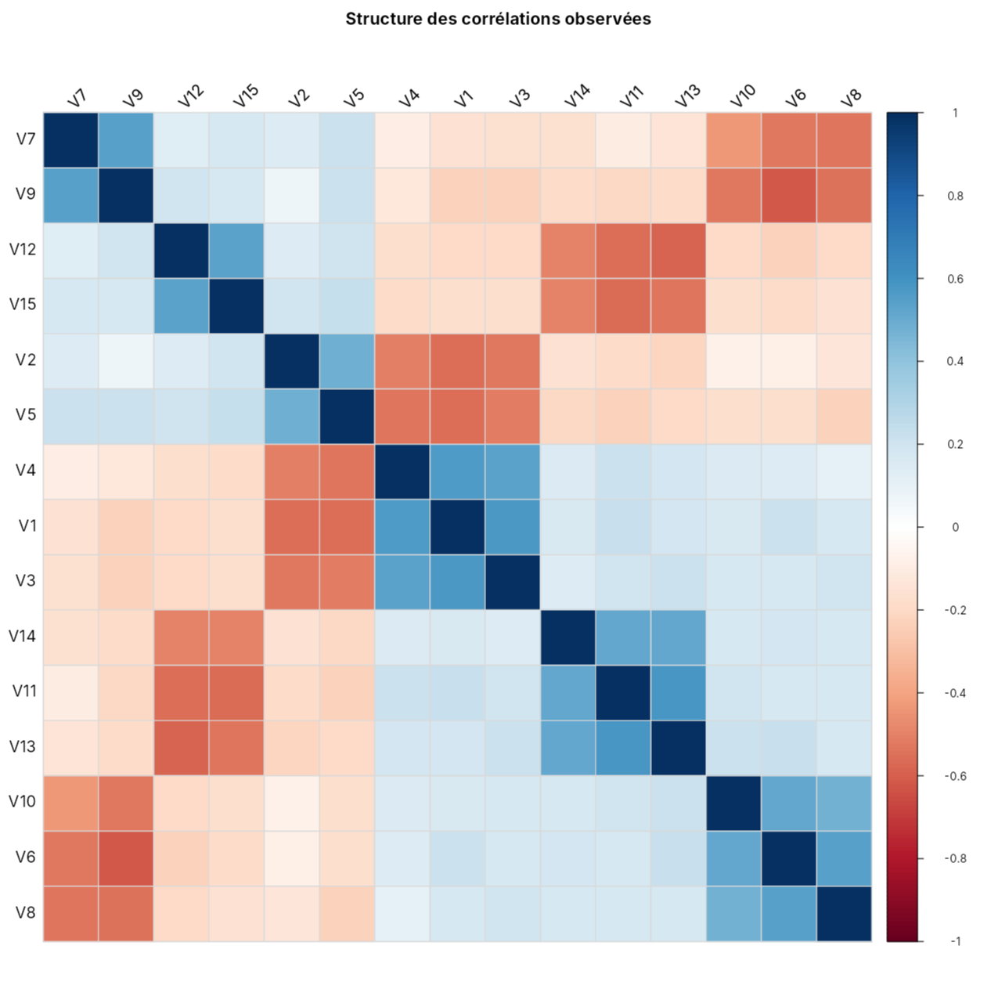

# Générer des données pour l'analyse factorielle exploratoire {#sec-afe}

```{r}
#| include: false
source("_common.R")
suppressMessages(library(psych))
congruence <- function(L_est, L_vrai) {
  cg <- abs(psych::factor.congruence(L_est, L_vrai))
  mean(apply(cg, 2, max))
}
afe_fil <- psych::fa(fil$response, 3, rotate = "oblimin", fm = "ml")
L_fil <- unclass(afe_fil$loadings)
# associer chaque facteur estimé au facteur vrai le plus congruent
ordre <- apply(abs(psych::factor.congruence(L_fil, fil$loadings)), 2, which.max)
L_fil <- L_fil[, ordre]; Phi_fil <- afe_fil$Phi[ordre, ordre]
signes <- sign(colSums(L_fil * fil$loadings)); L_fil <- sweep(L_fil, 2, signes, "*")
Phi_fil <- Phi_fil * outer(signes, signes)
```

::: {.callout-tip title="Objectifs d'apprentissage"}
À la fin de ce chapitre, vous devriez être capable de :

- expliquer pourquoi une AFE simulée permet de comparer une structure estimée à une structure populationnelle connue;
- décrire l'effet des charges principales, des charges secondaires, des corrélations factorielles, du nombre d'indicateurs et de la taille d'échantillon sur la difficulté de récupération d'une structure factorielle;
- justifier le choix d'une rotation oblique plutôt qu'orthogonale à partir de la structure populationnelle;
- concevoir une progression d'expériences en faisant varier un seul paramètre à la fois;
- interpréter une comparaison entre une solution AFE estimée et la structure populationnelle en tenant compte de l'indétermination du signe et de l'ordre des facteurs;
- reconnaître, dans une solution AFE, la signature d'items inversés et de réponses ordinales.
:::

::: {.callout-important title="Idée centrale"}
La difficulté d'une AFE ne dépend jamais d'une seule caractéristique de la population. Elle résulte de la combinaison de plusieurs propriétés — netteté des charges principales, présence de charges secondaires, corrélations entre facteurs, nombre d'indicateurs et taille de l'échantillon. La simulation permet précisément d'isoler l'effet de chacune, une à la fois.
:::

::: {.callout-warning title="Pièges classiques"}
- Attribuer une difficulté d'AFE à une seule caractéristique (par exemple la taille de l'échantillon) en ignorant les charges ou les corrélations factorielles qui jouent souvent un rôle tout aussi important.
- Modifier plusieurs contrôles à la fois en cherchant à comprendre un mécanisme précis : il devient alors impossible d'attribuer un changement observé à une cause particulière.
- Comparer directement une solution AFE estimée à la structure populationnelle sans tenir compte de l'indétermination du signe et de l'ordre des facteurs.
- Négliger de consulter l'onglet **Structure populationnelle** avant l'analyse, et donc juger une solution AFE sans référence connue.
- Traiter une rotation orthogonale comme un choix neutre alors que la population contient des facteurs corrélés.
:::

L'analyse factorielle exploratoire, ou AFE, constitue probablement l'usage le plus naturel du générateur. Le principe de l'AFE consiste à partir d'un ensemble de variables observées afin d'identifier la structure latente qui pourrait expliquer leurs relations. Dans une application réelle, cette structure est inconnue. Avec des données simulées, au contraire, nous connaissons exactement le nombre de facteurs, les charges factorielles, les corrélations entre facteurs et les composantes résiduelles qui ont servi à produire les observations. Nous pouvons donc comparer la structure estimée à la structure véritable.

Cette possibilité transforme l'AFE en véritable expérience méthodologique. On peut créer une structure très claire et vérifier qu'elle est facilement récupérée, puis rendre progressivement le problème plus difficile en réduisant les charges principales, en augmentant les charges secondaires, en rapprochant les facteurs ou en diminuant la taille de l'échantillon. L'intérêt n'est alors plus seulement d'obtenir une solution factorielle, mais de comprendre les conditions qui la rendent plus ou moins facile à retrouver.

## Ce que l'AFE cherche à récupérer

Supposons que les données soient produites par le modèle :

$$
\mathbf{X}
=
\boldsymbol{\Lambda}\mathbf{F}
+
\boldsymbol{\varepsilon}.
$$

L'analyse factorielle exploratoire cherche essentiellement à retrouver, à partir des corrélations observées entre les variables, une structure compatible avec la matrice de charges $\boldsymbol{\Lambda}$ et avec les relations entre les facteurs. Elle ne reçoit cependant aucune information directe sur le facteur principal de chaque variable. Cette structure doit émerger des données.

Dans le générateur, cette information est connue à l'avance. L'onglet **Structure populationnelle** montre les charges qui ont réellement servi à générer les observations. Après avoir effectué une AFE dans un logiciel externe, on peut donc comparer les charges estimées à ces valeurs populationnelles. Cette comparaison permet de distinguer ce qui appartient à la population de ce qui résulte de la fluctuation d'échantillonnage ou des limites de la méthode d'estimation.

## Générer un jeu approprié avec MultvarGen

Pour une première AFE, construisez délibérément une structure facile à récupérer. Dans **Structure des facteurs**, choisissez **3** facteurs et **Fixe — 5** variables par facteur. Dans **Corrélations et charges**, choisissez une corrélation factorielle **fixe de 0,30**, des charges principales **élevées (0,65–0,80)** et des charges secondaires **aucune (0)**. Conservez un seul groupe de **500** personnes, une distribution **normale** et des réponses **continues**.

Avant l'exportation, ouvrez **Structure populationnelle** : on doit y voir trois blocs de cinq indicateurs, sans charges croisées. Dans **Données → Description globale**, la matrice de corrélations observées devrait déjà rappeler ces trois blocs, avec des corrélations plus fortes à l'intérieur qu'entre eux (@fig-cap-correlations). Exportez ensuite les données individuelles et ajustez une AFE à trois facteurs avec une rotation oblique. Cette solution de référence sert de point de comparaison : pour étudier une difficulté précise, ne modifiez ensuite qu'un seul réglage à la fois.

## Commencer par une structure simple

Pour une première expérience, il est préférable de construire une population dont la structure factorielle est relativement nette. On peut, par exemple, générer trois facteurs comprenant chacun cinq indicateurs, utiliser des charges principales élevées, limiter fortement les charges secondaires et maintenir les corrélations entre facteurs à un niveau faible ou modéré. Avec un échantillon suffisamment grand, une telle configuration devrait produire une structure assez facile à identifier.

Dans ce scénario, les variables associées à un même facteur devraient présenter des corrélations relativement importantes entre elles, tandis que les relations entre les blocs devraient être plus faibles. Une représentation de la matrice de corrélations observées permet souvent d'apercevoir cette organisation avant même d'effectuer l'analyse factorielle.

::: {.callout-tip title="Scénario de départ"}
Une configuration simple pour commencer pourrait comporter trois facteurs, cinq variables principales par facteur, des charges principales fortes, peu ou pas de charges secondaires, des corrélations factorielles faibles et un échantillon d'environ 500 observations.
:::

L'objectif de ce premier scénario n'est pas de mettre l'AFE en difficulté. Il sert plutôt à vérifier que l'ensemble du parcours fonctionne comme prévu : génération, inspection de la structure populationnelle, exportation, analyse factorielle et comparaison entre la solution obtenue et la population connue.

## Le rôle des charges principales

Les charges principales déterminent dans quelle mesure chaque variable représente son facteur. Lorsque ces charges sont élevées, une part importante de la variance des variables est commune aux facteurs. Les ensembles d'indicateurs deviennent alors plus cohérents et la structure factorielle tend à apparaître plus nettement dans la matrice de corrélations.

Lorsque les charges principales diminuent, la variance résiduelle occupe une place plus importante. Les corrélations entre indicateurs d'un même facteur deviennent généralement moins fortes et les facteurs sont plus difficiles à identifier. Deux populations peuvent donc avoir exactement le même nombre de facteurs et la même organisation des indicateurs, tout en présentant des niveaux très différents de difficulté pour l'analyse factorielle.

Une expérience intéressante consiste à conserver tous les paramètres identiques et à modifier seulement l'intensité des charges principales. Avec une graine fixée ou des échantillons suffisamment grands, on peut alors observer directement l'effet de la qualité des indicateurs sur la récupération de la structure.

La @fig-afe-matrices montre deux populations construites de cette façon, avec la même graine : la première est celle du fil rouge, la seconde ajoute quatre difficultés à la fois (quatre facteurs plus corrélés, charges moyennes, nombreuses charges secondaires, 200 personnes). Les blocs restent visibles dans la seconde, mais beaucoup moins nets.

```{r}
#| label: fig-afe-matrices
#| fig-cap: "Corrélations observées dans deux échantillons (graine 2024). À gauche, la structure claire du fil rouge (N = 500); à droite, une structure difficile : 4 facteurs corrélés à 0,40, charges moyennes, charges secondaires aléatoires sur la moitié des cellules, N = 200."
#| fig-width: 8
#| fig-height: 4
#| out-width: "100%"
library(patchwork)
afe_dif <- generer(2024, nfact = 4, vpf = 5L, fc = 0.40, pl = "M", cl = "R",
                   cross_loading_prop = 0.5, group_sizes = 200L)
R1 <- fil_R; diag(R1) <- NA; R2 <- cor(afe_dif$response); diag(R2) <- NA
(heat(R1, "Structure claire") + theme(legend.position = "none", axis.text = element_text(size = 6))) +
  (heat(R2, "Structure difficile") + theme(axis.text = element_text(size = 6)))
```

## Les charges secondaires et la structure simple

Une structure factorielle parfaitement simple supposerait que chaque variable ne charge que sur un seul facteur. Dans les données réelles, cette situation est rarement parfaitement respectée. Une variable peut mesurer principalement une dimension tout en partageant une partie plus faible de sa variance avec d'autres facteurs.

Les charges secondaires permettent de reproduire cette situation. Leur influence dépend à la fois de leur amplitude et du nombre de variables concernées. Quelques charges secondaires faibles perturberont peu une structure claire, tandis que de nombreuses charges secondaires de taille non négligeable peuvent rendre l'appartenance factorielle de certaines variables beaucoup plus ambiguë.

Cette distinction permet de créer plusieurs degrés de difficulté. On peut d'abord produire une structure presque pure, puis augmenter la proportion de variables possédant des charges secondaires sans changer leur amplitude. Dans une autre expérience, on peut conserver la même proportion de variables concernées et augmenter seulement l'importance des charges secondaires.

::: {.callout-note title="Amplitude et fréquence ne sont pas la même chose"}
Deux jeux de données peuvent avoir le même niveau général de complexité pour des raisons différentes. L'un peut contenir quelques charges secondaires relativement fortes, tandis qu'un autre peut présenter de nombreuses charges secondaires faibles. Ces deux structures ne poseront pas nécessairement les mêmes difficultés à l'analyse factorielle.
:::

## Facteurs indépendants ou facteurs corrélés

Les facteurs peuvent être indépendants, mais de nombreuses constructions psychologiques, sociales ou éducatives sont naturellement corrélées. Une population dans laquelle les facteurs possèdent des relations non nulles constitue donc souvent un scénario plus réaliste.

Lorsque les facteurs sont faiblement corrélés, les blocs d'indicateurs demeurent généralement assez distincts. À mesure que les corrélations factorielles augmentent, les variables appartenant à des facteurs différents deviennent elles aussi davantage corrélées. La séparation entre les dimensions peut alors devenir moins évidente.

Cette caractéristique a aussi une conséquence méthodologique importante : lorsque les facteurs de la population sont corrélés, une rotation oblique est généralement plus cohérente avec le modèle générateur qu'une rotation imposant l'orthogonalité. La simulation permet précisément de montrer pourquoi. Si la population contient des facteurs corrélés, une solution orthogonale cherche à représenter cette structure sous une contrainte qui n'existe pas dans la population.

Une expérience utile consiste donc à générer une première population avec des facteurs indépendants, puis une seconde avec la même matrice de charges mais des corrélations factorielles modérées. La comparaison des solutions obtenues avec des rotations orthogonales et obliques permet de relier directement les choix analytiques à la structure véritable.

## Le nombre d'indicateurs par facteur

Le nombre de variables disponibles pour représenter chaque facteur influence également la stabilité de la solution. Un facteur représenté par plusieurs bons indicateurs laisse une empreinte plus importante dans la matrice de corrélations qu'un facteur défini par très peu de variables.

Une structure comprenant cinq ou six indicateurs par facteur offre généralement un scénario pédagogique confortable [@MacCallum1999]. À l'inverse, diminuer le nombre d'indicateurs peut rendre certains facteurs plus fragiles, surtout si les charges principales ne sont pas fortes ou si des charges secondaires sont présentes.

Le générateur permet aussi de produire un nombre variable d'indicateurs d'un facteur à l'autre. Cette option est utile pour éviter des structures artificiellement symétriques. Dans les données réelles, il est fréquent qu'une dimension soit représentée par davantage de variables qu'une autre.

## La taille de l'échantillon

Même lorsque la structure populationnelle est parfaitement définie, l'analyse factorielle porte sur une matrice de corrélations observées. Cette matrice fluctue d'un échantillon à l'autre, et cette fluctuation est d'autant plus importante que l'échantillon est petit.

Un petit échantillon peut donc produire une structure observée moins nette que celle qui existe réellement dans la population. Certaines charges estimées peuvent être instables, des facteurs peuvent sembler moins distincts et des charges secondaires accidentelles peuvent apparaître simplement en raison de l'échantillonnage.

L'expérience la plus directe consiste à conserver exactement la même population et à comparer plusieurs tailles d'échantillon. Avec $N=100$, puis $N=300$ et enfin $N=1000$, l'onglet **Vérification** permet déjà d'observer que la matrice de corrélations échantillonnale se rapproche progressivement de la matrice populationnelle. L'AFE effectuée sur ces mêmes données permettra ensuite d'examiner comment cette amélioration se traduit dans la récupération des facteurs.

Pour résumer la qualité de cette récupération, on utilise souvent le **coefficient de congruence de Tucker** entre une colonne de charges estimées et la colonne de charges vraies. Il vaut 1 lorsque les deux profils de charges sont proportionnels; au-delà d'environ 0,95, on considère habituellement que le facteur est retrouvé. La @fig-afe-recuperation résume une petite étude de simulation : pour deux populations qui ne diffèrent que par l'intensité des charges principales, elle répète 200 fois l'AFE à chaque taille d'échantillon.

```{r}
#| label: fig-afe-recuperation
#| cache: true
#| fig-cap: "Récupération de la structure par une AFE (maximum de vraisemblance, rotation oblimin, 3 facteurs) selon la taille de l'échantillon et l'intensité des charges principales (3 facteurs corrélés à 0,30, 5 items, aucune charge secondaire, graine 2024; 200 échantillons par condition). Congruence moyenne entre facteurs estimés et vrais : médiane et intervalle contenant 90 % des échantillons."
#| fig-height: 3.4
set.seed(41)
pops <- list("Charges élevées (0,65-0,80)" = generer(2024, pl = "H"),
             "Charges faibles (0,35-0,50)" = generer(2024, pl = "L"))
sim_afe <- do.call(rbind, lapply(names(pops), function(nm) {
  pop <- pops[[nm]]; S <- pop$population_correlation
  do.call(rbind, lapply(c(60, 100, 200, 400, 800), function(n) {
    v <- replicate(200, {
      x <- MASS::mvrnorm(n, rep(0, ncol(S)), S)
      f <- tryCatch(suppressWarnings(suppressMessages(
        psych::fa(x, 3, rotate = "oblimin", fm = "ml"))), error = function(e) NULL)
      if (is.null(f)) NA else congruence(unclass(f$loadings), pop$loadings)
    })
    data.frame(charges = nm, N = n, med = median(v, na.rm = TRUE),
               bas = quantile(v, 0.05, na.rm = TRUE), haut = quantile(v, 0.95, na.rm = TRUE))
  }))
}))
ggplot(sim_afe, aes(N, med, colour = charges, fill = charges)) +
  geom_ribbon(aes(ymin = bas, ymax = haut), alpha = 0.18, colour = NA) +
  geom_line(linewidth = 1) + geom_point(size = 2) +
  geom_hline(yintercept = 0.95, linetype = "dashed", colour = "grey40") +
  scale_x_log10(breaks = c(60, 100, 200, 400, 800)) +
  scale_y_continuous(labels = axe_fr, limits = c(NA, 1)) +
  scale_colour_manual(values = c(pal$bleu, pal$orange), name = NULL) +
  scale_fill_manual(values = c(pal$bleu, pal$orange), name = NULL) +
  labs(x = "Taille de l'échantillon (échelle logarithmique)", y = "Congruence moyenne")
```

Avec des charges élevées, la structure est retrouvée presque parfaitement dès une centaine de personnes. Avec des charges faibles, il en faut plusieurs centaines pour atteindre le même niveau, et la dispersion d'un échantillon à l'autre reste grande. La taille d'échantillon « suffisante » n'existe donc pas dans l'absolu : elle dépend de la qualité des indicateurs [@MacCallum1999].

## Normalité et asymétrie

L'AFE est souvent enseignée à partir de données approximativement normales, mais les variables réelles peuvent présenter des distributions asymétriques. Le générateur permet d'introduire cette caractéristique sans abandonner la structure factorielle qui définit les relations entre les variables.

Il devient alors possible de comparer une population approximativement normale à une population de structure factorielle similaire mais dont les variables sont davantage asymétriques. L'objectif n'est pas nécessairement de chercher une frontière précise à partir de laquelle l'AFE « cesse de fonctionner », mais plutôt d'observer comment les propriétés distributionnelles peuvent influencer les corrélations, les estimations et la stabilité de la solution.

Cette expérience est particulièrement intéressante lorsqu'elle est combinée à d'autres conditions difficiles. Une structure à fortes charges principales et grand échantillon peut demeurer assez robuste malgré une certaine asymétrie, alors qu'un petit échantillon accompagné de charges faibles et de distributions asymétriques constitue une situation beaucoup moins favorable.

## Items inversés et réponses ordinales

Deux options de l'application modifient la **forme** de la solution sans modifier le nombre de facteurs.

Avec des **items inversés**, certaines charges principales sont négatives. Une AFE les retrouve comme telles : l'item charge fortement sur son facteur, mais avec un signe négatif. Ce n'est pas un problème d'analyse; c'est l'information qui indique qu'il faudra recoder l'item avant de calculer un score. Dans la matrice de corrélations, les items inversés forment des bandes de couleur opposée à l'intérieur de leur bloc (@fig-cap-correlations-inverses).

{#fig-cap-correlations-inverses .capture width="62%"}

Avec des **réponses Likert**, les corrélations de Pearson calculées sur les codes sont atténuées, d'autant plus que le nombre de catégories est petit et que les seuils sont asymétriques. Une AFE sur ces corrélations sous-estime les charges. Une AFE sur des corrélations polychoriques retrouve des charges proches des valeurs populationnelles. Le chapitre 10 compare les deux approches.

## Un scénario volontairement difficile

Une fois une structure simple bien comprise, on peut construire un scénario qui accumule plusieurs difficultés : davantage de facteurs, charges principales moyennes, nombreuses charges secondaires, corrélations factorielles plus fortes et échantillon relativement petit.

Il ne s'agit pas de créer artificiellement un cas impossible, mais de montrer que la récupération d'une structure factorielle dépend de plusieurs propriétés simultanées. Lorsque l'analyse devient ambiguë, le problème ne vient pas nécessairement d'une mauvaise méthode. La population elle-même peut offrir une structure peu nette et l'échantillon peut encore accentuer cette ambiguïté.

Un scénario pédagogique intéressant pourrait comporter quatre facteurs, quatre ou cinq indicateurs par facteur, des charges principales moyennes, une proportion élevée de charges secondaires, des corrélations factorielles modérées et environ 200 observations. On peut alors comparer la solution obtenue à la matrice de charges populationnelle et identifier précisément les éléments qui ont été difficiles à récupérer.

## Combiner les paramètres progressivement

Il est tentant de modifier simultanément plusieurs contrôles pour créer des jeux de données « réalistes ». Cette stratégie est utile lorsqu'on veut simplement produire un exemple complexe, mais elle l'est beaucoup moins lorsqu'on cherche à comprendre un mécanisme.

Pour apprendre par simulation, il est généralement préférable de partir d'une configuration de référence puis de faire varier une caractéristique importante à la fois. On peut comparer charges fortes et charges moyennes, puis faible et forte présence de charges secondaires, puis facteurs indépendants et corrélés, puis petits et grands échantillons. Une fois ces effets compris séparément, on peut les combiner dans des scénarios plus complexes.

Cette logique permet de distinguer les conséquences de chaque propriété de la population. Elle transforme l'application en laboratoire plutôt qu'en simple producteur de jeux de données.

## Examiner la population avant l'analyse

Avant d'exporter les données, il est utile de consulter systématiquement l'onglet **Structure populationnelle**. La matrice des charges fournit la structure exacte que l'AFE devra tenter de récupérer, tandis que les communalités indiquent dans quelle mesure chaque variable est expliquée par les facteurs communs.

L'examen de la matrice de corrélations factorielles permet aussi de savoir si une solution oblique est théoriquement attendue. Enfin, l'onglet **Vérification** indique dans quelle mesure l'échantillon particulier reproduit la structure de corrélation de la population. Un échantillon exceptionnellement atypique peut ainsi être repéré avant même l'analyse.

Cette démarche est importante parce que l'interprétation d'une simulation ne doit pas reposer uniquement sur la solution obtenue par le logiciel externe. Le principal avantage de la simulation est précisément de connaître ce qui a été généré.

## Exporter pour l'AFE

Pour effectuer une analyse factorielle exploratoire dans un logiciel externe, deux stratégies principales sont possibles. La première consiste à exporter les données individuelles et à effectuer l'ensemble de l'analyse à partir de ces observations. Cette solution est généralement la plus souple, puisqu'elle permet d'examiner les distributions, de calculer les statistiques descriptives et de modifier les options d'analyse directement dans le logiciel utilisé.

La seconde consiste à exporter la matrice de corrélations observées lorsque le logiciel ou la procédure choisie permet une analyse à partir d'une matrice. Cette approche peut être pratique pour certaines démonstrations, mais elle ne conserve pas toute l'information contenue dans les données individuelles.

Dans un exercice pédagogique, l'utilisation des données brutes permet généralement de parcourir l'ensemble du processus analytique, depuis l'inspection des variables jusqu'à l'extraction et à la rotation des facteurs.

::: {.callout-note title="Si les données sont Likert ou incomplètes"}
Pour des réponses Likert, préférez une matrice de corrélations polychoriques et une méthode d'AFE adaptée aux variables ordinales lorsque le logiciel le permet. En présence de valeurs manquantes, décrivez d'abord leur ampleur et votre stratégie de traitement : la matrice exportée par l'application ne décide pas à votre place entre cas complets, imputation ou autre méthode.
:::

## Que comparer après l'analyse ?

Après avoir effectué l'AFE, le résultat le plus intéressant n'est pas simplement de savoir si une solution « semble bonne ». On peut la comparer directement à la population.

Le nombre de facteurs retenu peut d'abord être comparé au nombre véritable de facteurs. La structure des charges peut ensuite être examinée afin de vérifier si les variables sont principalement associées aux bons facteurs et si les charges secondaires importantes ont été retrouvées. Lorsque les facteurs de la population sont corrélés, leurs relations estimées peuvent également être comparées à la matrice factorielle populationnelle.

Il faut cependant tenir compte de l'indétermination habituelle de l'orientation et de l'ordre des facteurs. Un logiciel peut présenter les facteurs dans un ordre différent de celui utilisé par le générateur, et le signe d'un facteur peut être inversé sans modifier la solution substantielle. La comparaison doit donc porter sur la structure, et non sur la simple égalité ligne par ligne des sorties.

## Trois scénarios à essayer

Une première série d'expériences peut être organisée autour de trois populations de difficulté croissante.

### Structure claire

On peut commencer par trois facteurs comprenant chacun cinq indicateurs, avec des charges principales fortes, peu de charges secondaires, des facteurs faiblement corrélés et un échantillon de 500 observations. La solution attendue devrait être relativement nette et fournir une référence pour les expériences suivantes.

### Structure intermédiaire

On conserve trois facteurs mais on utilise des charges principales moyennes, quelques charges secondaires et des corrélations factorielles modérées. Avec environ 300 observations, la structure devrait demeurer identifiable tout en présentant davantage d'ambiguïtés.

### Structure difficile

Enfin, on peut augmenter le nombre de facteurs, utiliser des charges principales plus modestes, multiplier les charges secondaires, rapprocher davantage les facteurs et réduire l'échantillon à environ 150 ou 200 observations. Ce scénario permet d'observer ce qui se produit lorsque plusieurs conditions défavorables sont réunies.

Ces trois simulations ne doivent pas être considérées comme des catégories universelles de difficulté. Elles servent plutôt de progression pédagogique permettant de voir comment la qualité de la structure populationnelle et la précision de l'échantillonnage se combinent.

## Ce que ce scénario nous apprend

L'analyse factorielle exploratoire ne « découvre » pas mécaniquement une vérité cachée dans les données. Elle cherche une représentation parcimonieuse d'une matrice de relations observées, et cette matrice dépend elle-même de la structure populationnelle et de la fluctuation d'échantillonnage.

La simulation permet de rendre cette idée concrète. Lorsque la population contient des indicateurs fortement reliés à des facteurs bien distincts et que l'échantillon est grand, la structure est généralement facile à récupérer. Lorsque les facteurs sont fortement corrélés, que les indicateurs sont moins purs ou que l'échantillon est petit, l'incertitude augmente.

Le générateur permet donc de poser une question beaucoup plus riche que « quelle solution factorielle obtient-on ? ». Il permet de demander **quelles caractéristiques de la population rendent cette solution plus ou moins récupérable ?**

Le chapitre suivant adoptera la perspective complémentaire de l'**analyse factorielle confirmatoire**. Nous ne chercherons plus seulement à retrouver une structure inconnue, mais à générer des données correspondant à différentes conceptions d'un modèle de mesure, notamment les modèles parallèles, tau-équivalents et congénériques.

::: {.callout-note title="🖥️ Dans l'application"}
- **Structure populationnelle → Structure des variables** : la matrice que l'AFE doit retrouver, avec les communalités vraies.
- **Structure populationnelle → Structure des facteurs** : les corrélations entre facteurs, qui justifient une rotation oblique lorsqu'elles ne sont pas nulles.
- **Données → Description globale** : la matrice de corrélations observées, sous forme graphique, pour repérer les blocs avant l'analyse.
- **Données simulées → Télécharger les données** pour l'AFE elle-même; le **corrigé enseignant** contient la matrice des charges vraies pour la comparaison.
:::

## Laboratoire : comparer une AFE à la population {#sec-labo-4}

Générez la population fil rouge (graine 2024), téléchargez les données et réalisez une AFE à trois facteurs (maximum de vraisemblance, rotation oblimin) dans votre logiciel.

1. Les facteurs estimés apparaissent-ils dans le même ordre que `F1`, `F2` et `F3`?
2. Comparez les charges estimées de `V1` à `V5` aux charges vraies.
3. Comparez les corrélations estimées entre facteurs à la valeur populationnelle de 0,30.

::: {.callout-tip title="Réponse" collapse="true"}
1. Pas nécessairement : l'ordre et le signe des facteurs sont arbitraires. Dans R (`psych::fa`), le premier facteur estimé correspond ici à `r paste0("F", which.max(abs(psych::factor.congruence(unclass(afe_fil$loadings), fil$loadings))[1, ]))`. Il faut associer chaque facteur estimé au facteur vrai dont le profil de charges est le plus semblable (congruence de Tucker, toutes égales ou supérieures à `r fr(floor(1000 * min(apply(abs(psych::factor.congruence(unclass(afe_fil$loadings), fil$loadings)), 2, max))) / 1000, 3)` ici).
2. Une fois les facteurs associés :

```{r}
#| label: tbl-labo-afe
#| tbl-cap: "Charges vraies et estimées des cinq premiers items (population fil rouge, AFE par maximum de vraisemblance, rotation oblimin)."
tb <- data.frame(Item = paste0("V", 1:5), `Charge vraie` = fil$loadings[1:5, 1],
                 `Charge estimée` = L_fil[1:5, 1], Écart = L_fil[1:5, 1] - fil$loadings[1:5, 1],
                 `Plus forte charge secondaire estimée` = apply(abs(L_fil[1:5, -1]), 1, max),
                 check.names = FALSE)
tab_fr(tb, 3)
```

Les charges principales sont retrouvées à quelques centièmes près, et les charges secondaires estimées restent très petites alors que les vraies sont nulles : c'est la fluctuation d'échantillonnage.

3. Les corrélations estimées entre facteurs valent `r fr(Phi_fil[1, 2], 2)`, `r fr(Phi_fil[1, 3], 2)` et `r fr(Phi_fil[2, 3], 2)`, autour de la valeur populationnelle de 0,30. Une rotation orthogonale aurait imposé des corrélations nulles, contraires à la population.
:::

::: {.callout-important title="À retenir"}
- La simulation fournit le corrigé de l'AFE : nombre de facteurs, charges et corrélations vraies.
- La récupération dépend conjointement des charges, des charges secondaires, des corrélations entre facteurs, du nombre d'items et de $N$; il faut faire varier une seule caractéristique à la fois.
- On compare des structures, pas des colonnes : l'ordre et le signe des facteurs estimés sont arbitraires (congruence de Tucker).
- Une population à facteurs corrélés appelle une rotation oblique.
- Des charges négatives signalent des items inversés; des réponses Likert appellent des corrélations polychoriques.
:::

## Erreurs fréquentes

| Erreur | Ce qu'il faut retenir |
|---|---|
| Attribuer la difficulté d'une AFE à un seul paramètre | Charges principales, charges secondaires, corrélations factorielles, nombre d'indicateurs et taille d'échantillon interagissent tous |
| Modifier plusieurs contrôles à la fois pour comprendre un effet | Il faut isoler une caractéristique à la fois pour pouvoir lui attribuer un résultat observé |
| Comparer les facteurs estimés aux facteurs population ligne par ligne | L'ordre et le signe des facteurs estimés sont indéterminés; il faut comparer les structures, pas les valeurs brutes |
| Choisir systématiquement une rotation orthogonale | Elle n'est justifiée que si les facteurs populationnels sont eux-mêmes indépendants |
| Analyser une solution AFE sans avoir consulté la structure populationnelle | On perd alors la seule référence connue permettant de juger la qualité de la récupération |

## Quiz

::: {.callout-note title="Question 1 — numérique" collapse="true"}
Une population comporte 4 facteurs avec exactement 5 variables principales par facteur (nombre fixe). Combien de variables observées la population compte-t-elle au total?

**Réponse : 20.** $4 \times 5 = 20$ variables observées.
:::

::: {.callout-note title="Question 2 — vrai ou faux" collapse="true"}
Vrai ou faux : une rotation orthogonale est un choix théoriquement neutre, peu importe que les facteurs de la population soient corrélés ou non.

**Réponse : Faux.** Une rotation orthogonale impose une contrainte d'indépendance entre les facteurs estimés. Si la population contient des facteurs corrélés, cette contrainte ne correspond pas au mécanisme générateur; une rotation oblique est alors plus cohérente.
:::

::: {.callout-note title="Question 3 — vrai ou faux" collapse="true"}
Vrai ou faux : augmenter la taille de l'échantillon peut réduire l'apparition de charges secondaires « accidentelles », c'est-à-dire des charges qui semblent présentes dans la solution estimée sans exister réellement dans la population.

**Réponse : Vrai.** Un petit échantillon amplifie la fluctuation d'échantillonnage, ce qui peut produire des associations apparentes entre une variable et un facteur qui ne lui est pas réellement associé dans la population.
:::

::: {.callout-note title="Question 4 — diagnostic de scénario" collapse="true"}
Vous générez deux populations identiques à un détail près : la première utilise des charges principales **Élevées**, la seconde des charges principales **Faibles**. Les deux ont les mêmes charges secondaires (Aucune), les mêmes corrélations factorielles et un échantillon de même taille ($N=500$). Sans effectuer l'analyse, que devriez-vous prédire à propos de la solution AFE obtenue dans chaque cas?

**Réponse :** Dans la première population, les indicateurs d'un même facteur devraient présenter des corrélations plus fortes entre eux, des communalités plus élevées et une structure factorielle plus facile à récupérer nettement. Dans la seconde, la variance résiduelle occupant une place plus importante, les corrélations intra-bloc seront plus faibles, les communalités plus basses, et la solution AFE sera généralement moins nette — les facteurs pourraient être plus difficiles à distinguer même si l'échantillon est identique et suffisamment grand dans les deux cas.
:::
