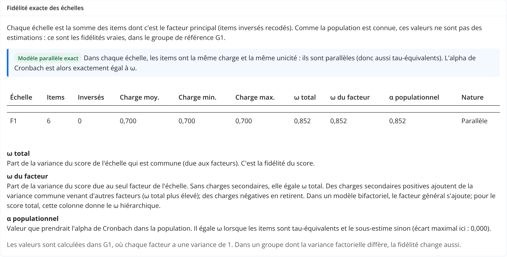
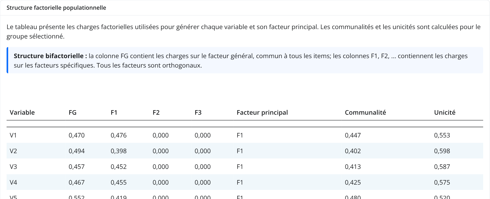
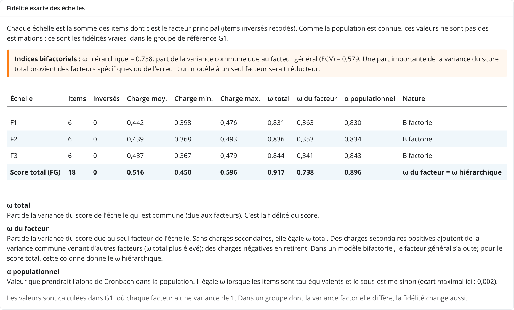

# Générer des données pour l'analyse factorielle confirmatoire {#sec-afc}

```{r}
#| include: false
source("_common.R")
suppressMessages(library(lavaan))
items6 <- paste0("V", 1:6)
m_cong <- paste("F =~", paste(items6, collapse = " + "))
m_tau  <- paste("F =~", paste0("a*", items6, collapse = " + "))
m_par  <- paste(m_tau, paste0(items6, " ~~ t*", items6, collapse = "\n"), sep = "\n")
ajuster3 <- function(d) {
  X <- as.data.frame(d$response)
  f <- lapply(list(m_cong, m_tau, m_par), function(m) cfa(m, X, std.lv = TRUE))
  a <- anova(f[[1]], f[[2]], f[[3]])
  list(fits = f, chi = sapply(f, fitMeasures, "chisq"), dl = sapply(f, fitMeasures, "df"),
       dchi = a[["Chisq diff"]][2:3], ddl = a[["Df diff"]][2:3], p = a[["Pr(>Chisq)"]][2:3])
}
pop_cong <- generer(2024, nfact = 1, vpf = 6L, group_sizes = 1000L)
pop_par  <- generer(2024, nfact = 1, vpf = 6L, pl = 0.70, group_sizes = 1000L)
res_cong <- ajuster3(pop_cong); res_par <- ajuster3(pop_par)
pop_bif  <- generer(2024, nfact = 3, vpf = 6L, structure = "bifactor", gl = "M", pl = "L")
rel_bif  <- population_reliability(pop_bif)
ecv_bif  <- sum(pop_bif$loadings[, 1]^2) / sum(pop_bif$loadings^2)
```

::: {.callout-tip title="Objectifs d'apprentissage"}
À la fin de ce chapitre, vous devriez être capable de :

- distinguer, à l'aide des contraintes imposées sur $\boldsymbol{\Lambda}$ et $\boldsymbol{\Theta}$, les modèles parallèle, tau-équivalent et congénérique;
- déterminer sous quelles conditions précises le générateur peut produire un modèle exactement parallèle ou tau-équivalent, et pourquoi ces conditions ne sont généralement pas remplies;
- relier une mauvaise spécification du modèle CFA (par exemple des charges secondaires omises) à une détérioration attendue de l'ajustement, distincte de la fluctuation d'échantillonnage;
- expliquer les notions d'invariance configurationnelle et d'invariance métrique dans le contexte du générateur multigroupe, et nommer une limite explicite du générateur pour les scénarios de non-invariance;
- justifier le choix d'un modèle CFA multifactoriel plutôt qu'un modèle à un facteur à partir des corrélations factorielles populationnelles;
- relier l'écart entre alpha et oméga à la tau-équivalence des items;
- interpréter un modèle bifactoriel à l'aide du ω hiérarchique et de la part de variance commune expliquée par le facteur général (ECV).
:::

::: {.callout-important title="Idée centrale"}
Un modèle CFA est essentiellement un ensemble de contraintes imposées à $\boldsymbol{\Lambda}$, $\boldsymbol{\Phi}$ et $\boldsymbol{\Theta}$. Parce que la simulation permet de savoir exactement quelles contraintes sont vraies dans la population, elle permet de distinguer un mauvais ajustement causé par la fluctuation d'échantillonnage d'un mauvais ajustement causé par une mauvaise spécification du modèle.
:::

::: {.callout-warning title="Pièges classiques"}
- Croire que le générateur ne peut **jamais** produire un modèle parallèle ou tau-équivalent exact : c'est possible dans un cas précis, décrit plus loin dans ce chapitre.
- Interpréter automatiquement un mauvais ajustement comme un problème d'estimation, sans envisager une mauvaise spécification (par exemple des charges secondaires omises dans le modèle CFA).
- Croire que le générateur peut violer n'importe quel niveau d'invariance : par défaut, il respecte toutes les formes d'invariance (configurationnelle, métrique, scalaire et stricte); il peut violer l'invariance scalaire pour un seul item de `G2` (DIF), mais jamais l'invariance métrique ni l'invariance stricte.
- Oublier l'indétermination du signe et de l'ordre des facteurs lorsqu'on compare une solution CFA estimée aux valeurs populationnelles.
- Confondre une corrélation factorielle forte avec une absence de validité discriminante : les facteurs restent deux entités distinctes dans la population, même si leur relation observée devient difficile à distinguer d'un facteur unique.
:::

L'analyse factorielle confirmatoire, ou AFC au sens de *confirmatory factor analysis* (CFA), part d'une logique différente de l'analyse factorielle exploratoire. En AFE, la structure est recherchée à partir des données. En CFA, la structure est spécifiée à l'avance : on indique quelles variables sont censées mesurer quels facteurs, quels paramètres doivent être estimés et quelles contraintes définissent le modèle.

Le générateur est particulièrement utile dans ce contexte parce qu'il permet justement de créer des données à partir d'une structure factorielle connue. On peut donc spécifier une population, générer un échantillon, ajuster ensuite un modèle CFA dans un logiciel externe, puis comparer les paramètres estimés aux valeurs qui ont réellement servi à produire les données.

L'intérêt pédagogique ne consiste pas seulement à vérifier qu'un modèle bien spécifié retrouve correctement sa structure. On peut aussi créer des situations où certaines contraintes sont appropriées, d'autres trop fortes, ou encore comparer différents modèles de mesure appliqués à une même population.

## Le modèle de mesure

Pour un ensemble de variables observées, le modèle général reste :

$$
\mathbf{X}
=
\boldsymbol{\Lambda}\mathbf{F}
+
\boldsymbol{\varepsilon}.
$$

Dans une CFA, la matrice $\boldsymbol{\Lambda}$ n'est cependant pas laissée entièrement libre. Sa structure est déterminée par le modèle théorique. Certaines charges sont estimées, d'autres sont fixées à zéro, et certaines peuvent être contraintes à être égales.

La matrice de covariance populationnelle s'écrit :

$$
\boldsymbol{\Sigma}
=
\boldsymbol{\Lambda}
\boldsymbol{\Phi}
\boldsymbol{\Lambda}^{\mathsf T}
+
\boldsymbol{\Theta}.
$$

Le modèle CFA cherche donc à expliquer la covariance observée à partir de trois grandes composantes : les charges factorielles, les relations entre les facteurs et les variances résiduelles.

Le générateur permet de contrôler directement une grande partie de cette structure, même s'il ne s'agit pas d'un éditeur SEM complet dans lequel chaque paramètre pourrait être fixé individuellement.

## Générer un jeu approprié avec MultvarGen

Pour ajuster un premier modèle CFA bien spécifié, choisissez **3** facteurs et **Fixe — 5** variables par facteur. Fixez la corrélation entre facteurs à **0,30**, sélectionnez des charges principales **élevées (0,65–0,80)** et des charges secondaires **aucune (0)**. Générez un seul groupe de **500** observations, avec une distribution **normale** et des réponses **continues**.

Dans le logiciel CFA, spécifiez trois facteurs corrélés : chaque indicateur ne charge que sur son facteur principal. Avant d'interpréter l'ajustement, consultez **Structure populationnelle** pour relever les charges et les corrélations effectivement générées; puis utilisez **Vérification** pour situer l'écart attendu entre population et échantillon. Cet exemple produit une référence cohérente : pour créer une mauvaise spécification, conservez les données mais omettez ensuite une relation réellement présente dans le modèle analysé.

## Un premier scénario CFA simple

Un point de départ naturel consiste à générer plusieurs facteurs, chacun mesuré par plusieurs indicateurs, avec de fortes charges principales et peu ou pas de charges secondaires.

On peut, par exemple, générer trois facteurs avec cinq indicateurs par facteur, des charges principales élevées, aucune charge secondaire et des corrélations factorielles modérées. Un grand échantillon, par exemple $N=500$ ou davantage, facilitera ensuite la récupération des paramètres.

Dans le logiciel CFA, chaque variable est alors associée uniquement à son facteur principal. Les corrélations entre facteurs peuvent être librement estimées si la population a été générée avec des facteurs corrélés.

Ce scénario permet de vérifier une idée fondamentale : lorsque le modèle ajusté correspond correctement au modèle générateur et que l'échantillon est suffisamment informatif, les estimations devraient se rapprocher des paramètres populationnels.

## Modèles parallèles, tau-équivalents et congénériques

Les modèles de mesure à un facteur peuvent être distingués selon les contraintes imposées aux indicateurs. Trois modèles classiques sont particulièrement utiles pour comprendre cette logique : le modèle parallèle, le modèle tau-équivalent et le modèle congénérique.

Ces modèles ne décrivent pas trois types de facteurs complètement différents. Ils représentent plutôt trois niveaux de contrainte sur les relations entre les indicateurs et le facteur latent.

## Le modèle parallèle

Dans un modèle parallèle, les indicateurs sont supposés avoir la même relation avec le facteur latent et la même quantité de variance résiduelle.

Pour plusieurs indicateurs d'un même facteur, on peut représenter cette idée par :

$$
X_j
=
\lambda F
+
\varepsilon_j,
$$

avec :

$$
\lambda_1=\lambda_2=\cdots=\lambda_p=\lambda
$$

et :

$$
\theta_1=\theta_2=\cdots=\theta_p=\theta.
$$

Les indicateurs ont donc des charges égales et des variances résiduelles égales.

Lorsque leurs intercepts sont également contraints de manière appropriée, ils possèdent des propriétés très similaires sur le plan de la moyenne et de la variance observée.

Le modèle parallèle représente une situation très restrictive. Il peut être utile comme modèle théorique ou comme point de comparaison, mais il correspond rarement exactement à des données psychométriques réelles.

## Le modèle tau-équivalent

Le modèle tau-équivalent relâche une partie de ces contraintes.

Les indicateurs possèdent toujours la même charge sur le facteur :

$$
\lambda_1=\lambda_2=\cdots=\lambda_p,
$$

mais leurs variances résiduelles peuvent différer :

$$
\theta_1,\theta_2,\ldots,\theta_p.
$$

Les variables peuvent donc avoir des niveaux de précision différents tout en représentant le facteur avec la même force fondamentale.

Le modèle tau-équivalent joue un rôle important en théorie classique des tests, notamment parce que plusieurs résultats associés au coefficient alpha de Cronbach reposent sur des hypothèses proches de la tau-équivalence.

## Le modèle congénérique

Le modèle congénérique est beaucoup moins contraignant. Les indicateurs peuvent avoir des charges différentes :

$$
\lambda_1,\lambda_2,\ldots,\lambda_p,
$$

et des variances résiduelles différentes :

$$
\theta_1,\theta_2,\ldots,\theta_p.
$$

Ils mesurent le même facteur, mais avec des intensités et des précisions différentes.

Cette situation est souvent plus réaliste. Deux items destinés à mesurer une même construction n'ont aucune raison de présenter exactement la même charge factorielle ou exactement la même variance résiduelle.

Le modèle congénérique constitue donc un cadre général dans lequel les modèles parallèles et tau-équivalents peuvent être considérés comme des cas plus contraints.

## Ce que le générateur produit par défaut

Dès que les charges principales sont tirées dans une plage — Faibles, Moyennes, Élevées ou Aléatoires — le générateur produit naturellement des structures **congénériques**.

Les charges principales ne sont alors pas imposées à une valeur identique pour tous les indicateurs. Elles sont générées dans un intervalle correspondant au niveau choisi. Deux variables appartenant au même facteur peuvent donc présenter des charges légèrement différentes.

Comme les communalités diffèrent avec les charges, leurs composantes résiduelles peuvent également différer.

Une structure générée avec des charges principales élevées et sans charges secondaires ressemble donc à un modèle CFA simple, mais elle n'est pas automatiquement parallèle ou tau-équivalente.

::: {.callout-note title="Une distinction importante"}
Choisir « charges fortes » ne signifie pas que toutes les charges seront identiques. Le contrôle détermine une plage de valeurs, pas une contrainte d'égalité entre indicateurs.
:::

Cette caractéristique est importante pour l'interprétation des scénarios. Le générateur est très bien adapté à la création de populations CFA congénériques dès que les charges principales varient d'un indicateur à l'autre.

## Peut-on générer exactement un modèle parallèle ?

Oui, dans un cas précis.

Pour obtenir un modèle strictement parallèle, il faut imposer simultanément :

$$
\lambda_1=\lambda_2=\cdots=\lambda_p
$$

et :

$$
\theta_1=\theta_2=\cdots=\theta_p.
$$

Si les **charges factorielles principales** sont réglées sur **Fixe** avec une seule valeur $\lambda$, et qu'**aucune charge secondaire** n'est ajoutée, chaque indicateur reçoit exactement la même charge $\lambda$ sur son facteur. Comme la variance de chaque facteur vaut 1 dans le groupe de référence, quel que soit le niveau de corrélation choisi entre les facteurs, la communalité de chaque indicateur vaut alors exactement $\lambda^2$ — et donc sa composante résiduelle $\theta = 1-\lambda^2$ est elle aussi identique pour tous les indicateurs. Le sous-onglet **Fidélité populationnelle** le confirme par un badge **Modèle parallèle exact**.

Cette configuration produit donc un modèle strictement parallèle, et non une simple approximation. Comme $\boldsymbol{\Lambda}$ et $\boldsymbol{\Theta}$ demeurent communs à l'ensemble des groupes dans le générateur, cette propriété tient même dans une simulation multigroupe.

Dès que les charges principales sont tirées dans une plage (Faibles, Moyennes, Élevées ou Aléatoires) ou que des charges secondaires sont introduites, cette égalité disparaît et la structure redevient congénérique.

::: {.callout-tip title="Une configuration facile à manquer"}
Le mode « Fixe » des charges principales est souvent utilisé simplement pour contrôler l'intensité moyenne d'une structure. Il produit pourtant, comme effet secondaire, une structure parallèle exacte dès que les charges secondaires sont désactivées — une propriété utile à connaître plutôt qu'à découvrir par accident.
:::

## Peut-on générer exactement un modèle tau-équivalent ?

Le modèle tau-équivalent exige seulement l'égalité des charges, $\lambda_1=\cdots=\lambda_p$, en laissant les variances résiduelles libres. Il s'agit d'une contrainte plus faible que le parallélisme : toute configuration produisant un modèle parallèle exact (charges principales fixes, aucune charge secondaire) satisfait donc automatiquement aussi la tau-équivalence.

En dehors de ce cas précis, dès que les charges principales sont tirées dans une plage plutôt que fixées à une valeur unique, les charges générées varient d'un indicateur à l'autre et ni la tau-équivalence ni le parallélisme ne sont respectés exactement. Le générateur permet alors seulement de produire des structures plus ou moins homogènes, sans égalité stricte entre les charges.

Une conséquence est moins évidente : le générateur ne peut pas produire une population tau-équivalente **qui ne soit pas** parallèle. Comme chaque item a une variance totale de 1, des charges égales entraînent nécessairement des unicités égales. Pour étudier des items tau-équivalents de précisions différentes, il faudrait un générateur qui laisse varier la variance totale des items.

## Pourquoi cette distinction est pédagogiquement intéressante

Cette distinction fournit un excellent exercice, dans les deux directions.

On peut d'abord générer une population **congénérique** — charges principales Moyennes ou Élevées, sans les fixer à une valeur unique — comprenant plusieurs indicateurs d'un même facteur, puis ajuster successivement trois modèles CFA :

1. un modèle parallèle;
2. un modèle tau-équivalent;
3. un modèle congénérique.

Comme la population générée est congénérique, le troisième modèle correspond le mieux à la structure véritable. Les deux premiers ajoutent des contraintes d'égalité qui ne sont pas présentes dans la population.

On peut ensuite faire l'inverse : générer une population **strictement parallèle** (charges principales Fixe, aucune charge secondaire), puis ajuster les trois mêmes modèles. Cette fois, le modèle parallèle devrait être celui qui correspond le mieux à la structure véritable, et les indices d'ajustement des trois modèles devraient être très proches les uns des autres, puisque les contraintes supplémentaires ne coûtent rien lorsqu'elles sont vraies dans la population.

Cette double expérience permet de comprendre la hiérarchie des modèles beaucoup plus concrètement qu'en étudiant seulement leurs définitions : on observe directement le coût d'une contrainte fausse, et l'absence de coût d'une contrainte vraie.

## Fidélité : alpha, oméga et tau-équivalence

La distinction entre modèles parallèle, tau-équivalent et congénérique a une conséquence très concrète pour la fidélité d'un score. Pour un score total $T = X_1 + \cdots + X_p$ mesurant un seul facteur, la fidélité est la part de la variance du score qui est due au facteur :

$$
\omega = \frac{\left(\sum_j \lambda_j\right)^2}{\left(\sum_j \lambda_j\right)^2 + \sum_j \theta_j}.
$$

Le coefficient alpha de Cronbach, lui, se calcule à partir des seules variances et covariances :

$$
\alpha = \frac{p}{p-1}\left(1 - \frac{\sum_j \sigma^2_j}{\sigma^2_T}\right).
$$

Les deux coïncident exactement lorsque les items sont tau-équivalents. Pour des items congénériques, alpha **sous-estime** la fidélité; l'écart grandit avec l'hétérogénéité des charges [@McDonald1999; @McNeish2018]. La @fig-alpha-omega le montre pour six items dont la charge moyenne est fixée à 0,60.

```{r}
#| label: fig-alpha-omega
#| fig-cap: "Fidélité populationnelle d'une échelle de six items de charge moyenne 0,60, selon l'étendue des charges (de 0 : items parallèles, à 0,60 : charges de 0,30 à 0,90). L'alpha égale ω pour des items parallèles et le sous-estime de plus en plus lorsque les charges deviennent inégales."
#| fig-height: 3.2
etendues <- seq(0, 0.6, by = 0.02)
fid <- do.call(rbind, lapply(etendues, function(e) {
  l <- 0.60 + seq(-e / 2, e / 2, length.out = 6); th <- 1 - l^2
  S <- tcrossprod(l) + diag(th); tot <- sum(S)
  data.frame(etendue = e, omega = sum(l)^2 / tot, alpha = 6 / 5 * (1 - sum(diag(S)) / tot))
}))
fl <- rbind(data.frame(etendue = fid$etendue, v = fid$omega, indice = "ω (fidélité vraie)"),
            data.frame(etendue = fid$etendue, v = fid$alpha, indice = "α de Cronbach"))
ggplot(fl, aes(etendue, v, colour = indice)) + geom_line(linewidth = 1.1) +
  scale_colour_manual(values = c(pal$orange, pal$bleu), name = NULL) +
  scale_x_continuous(labels = axe_fr) + scale_y_continuous(labels = axe_fr) +
  labs(x = "Étendue des charges (maximum − minimum)", y = "Fidélité populationnelle")
```

L'écart reste modeste tant que les charges sont semblables : il n'atteint `r fr(max(fid$omega - fid$alpha), 3)` que pour des charges allant de 0,30 à 0,90. Il est en revanche beaucoup plus grand lorsque les items mesurent plusieurs facteurs ou qu'un item inversé n'est pas recodé.

Le sous-onglet **Fidélité populationnelle** de l'application donne ces quantités exactes pour chaque échelle générée (@fig-cap-fidelite-parallele).

{#fig-cap-fidelite-parallele .capture width="92%"}

Avec plusieurs facteurs, l'application distingue deux quantités pour chaque échelle. Le **ω total** est la part de variance du score due à **l'ensemble** des facteurs; le **ω du facteur** est la part due au **seul** facteur que l'échelle est censée mesurer. Sans charges secondaires, les deux coïncident. Avec des charges secondaires, une partie de la variance commune du score provient d'autres facteurs : un score peut alors être très fidèle tout en mesurant un mélange de dimensions.

## Un scénario de comparaison des modèles de mesure

On peut générer un seul facteur avec six ou huit indicateurs, utiliser des charges principales moyennes ou fortes, aucune charge secondaire et un échantillon relativement grand.

La structure populationnelle montrera que toutes les variables mesurent le même facteur, mais avec des charges légèrement différentes.

Dans le logiciel CFA, on peut alors ajuster d'abord un modèle congénérique où toutes les charges sont librement estimées. On ajuste ensuite un modèle tau-équivalent en contraignant les charges à l'égalité, puis un modèle parallèle en imposant des contraintes supplémentaires sur les variances résiduelles.

L'objectif n'est pas simplement de choisir le modèle ayant le meilleur indice d'ajustement. Il s'agit de relier les différences d'ajustement aux contraintes que nous savons être vraies ou fausses dans la population.

## Plusieurs facteurs corrélés

La CFA devient particulièrement intéressante lorsque plusieurs facteurs sont présents.

On peut générer, par exemple, trois facteurs comprenant chacun quatre ou cinq indicateurs. Les variables sont principalement associées à leur facteur respectif, et les facteurs peuvent être modérément corrélés.

Le modèle CFA correspondant peut alors être représenté schématiquement par :

$$
F_1 \leftrightarrow F_2,
$$

$$
F_1 \leftrightarrow F_3,
$$

$$
F_2 \leftrightarrow F_3,
$$

avec chaque ensemble d'indicateurs relié à son facteur.

Ce scénario permet d'étudier simultanément la récupération des charges factorielles et celle des corrélations entre facteurs.

Lorsque les corrélations populationnelles entre facteurs sont connues, les estimations obtenues dans la CFA peuvent être comparées directement à ces valeurs.

## Charges secondaires et mauvaise spécification

Un modèle CFA simple impose souvent que chaque variable ne charge que sur un seul facteur. Cette structure peut être parfaitement appropriée dans certains scénarios, mais elle devient incorrecte si la population contient des charges secondaires.

Le générateur permet précisément de créer cette situation.

Supposons qu'une proportion des variables possède une charge secondaire faible ou modérée. Si le modèle CFA ajusté fixe toutes ces charges à zéro, il est alors légèrement mal spécifié.

Plus les charges secondaires sont nombreuses ou importantes, plus l'écart entre le modèle estimé et la population devient substantiel.

Cette expérience permet d'illustrer une idée essentielle : un mauvais ajustement n'est pas toujours un problème d'échantillon ou d'estimation. Il peut signaler que les contraintes du modèle ne correspondent pas à la structure populationnelle.

::: {.callout-tip title="Une expérience très instructive"}
Générez d'abord les données sans charges secondaires et ajustez un modèle CFA à structure simple. Générez ensuite une nouvelle population identique sauf pour l'ajout de charges secondaires. Réajustez exactement le même modèle. La différence entre les deux situations provient alors directement de la mauvaise spécification introduite.
:::

## Les indices d'ajustement dans une simulation

Dans des données réelles, les indices d'ajustement sont utilisés pour juger dans quelle mesure un modèle est compatible avec les données observées.

Dans une simulation, leur interprétation peut être enrichie parce que nous connaissons la population.

Si un modèle correspond exactement à la structure génératrice, un mauvais ajustement observé dans un échantillon particulier peut résulter en partie de la fluctuation d'échantillonnage.

Si le modèle impose des contraintes absentes de la population, une détérioration systématique de l'ajustement est au contraire attendue.

La simulation permet donc de relier les indices d'ajustement à une notion plus fondamentale : **la distance entre le modèle spécifié et le mécanisme qui a réellement produit les données**.

## Corrélations factorielles fortes

Lorsque deux facteurs sont fortement corrélés, leur distinction peut devenir moins nette.

Dans une CFA, cela peut soulever des questions de validité discriminante. Deux facteurs théoriquement distincts peuvent présenter une relation tellement forte qu'un modèle à un seul facteur devient éventuellement compétitif.

Le générateur permet d'étudier cette situation en conservant exactement la même structure de charges tout en faisant varier les corrélations factorielles.

On peut, par exemple, comparer une population dans laquelle :

$$
\rho_{F_1F_2}=0{,}20
$$

à une autre dans laquelle :

$$
\rho_{F_1F_2}=0{,}70.
$$

Dans le second cas, les deux ensembles d'indicateurs demeurent associés à des facteurs différents dans la population, mais leurs relations observées deviennent beaucoup plus semblables.

Cette manipulation permet d'étudier la capacité d'une CFA à distinguer des facteurs fortement reliés.

## Taille de l'échantillon et estimation des paramètres

Comme pour l'AFE, la récupération des paramètres CFA dépend de la taille de l'échantillon.

Avec un petit échantillon, les charges estimées, les variances résiduelles et les corrélations factorielles peuvent fluctuer sensiblement. Les erreurs-types sont plus importantes et les indices d'ajustement peuvent eux aussi varier davantage.

Avec un grand échantillon, les estimations devraient généralement se rapprocher des paramètres populationnels lorsque le modèle est correctement spécifié.

Une expérience particulièrement claire consiste à utiliser une même structure CFA et à comparer plusieurs tailles d'échantillon. L'objectif est alors de voir non seulement si le modèle converge, mais surtout comment la précision des paramètres estimés évolue.

## Un modèle à un facteur contre plusieurs facteurs

Une autre expérience classique consiste à générer plusieurs facteurs corrélés, puis à comparer un modèle CFA correspondant à cette structure avec un modèle plus simple dans lequel toutes les variables chargent sur un seul facteur.

Si les facteurs populationnels sont bien distincts, le modèle multifactoriel devrait représenter plus fidèlement la covariance observée.

À mesure que les corrélations entre facteurs augmentent, la différence entre les deux modèles peut cependant diminuer.

Cette expérience illustre directement le compromis entre parcimonie et fidélité au modèle générateur.

## Le modèle bifactoriel

Le modèle bifactoriel propose une autre manière de représenter des sous-échelles reliées [@Holzinger1937; @Reise2012]. Au lieu de facteurs corrélés, il pose un **facteur général** qui influence tous les items et des **facteurs spécifiques**, orthogonaux au facteur général et entre eux, qui ne rendent compte que de ce que les items d'une même échelle partagent en plus :

$$
\boldsymbol{\Lambda} =
\begin{pmatrix}
\lambda_{1G} & \lambda_{11} & 0 \\
\vdots & \vdots & \vdots \\
\lambda_{pG} & 0 & \lambda_{pk}
\end{pmatrix},
\qquad
\boldsymbol{\Phi} = \mathbf{I}.
$$

Dans l'application, on obtient cette structure en choisissant **Type de structure : Bifactorielle**. Le nombre de facteurs désigne alors les facteurs spécifiques; le réglage **Charges sur le facteur général** fixe l'intensité de `FG`. Le préréglage **Détresse psychologique** en est un exemple.

{#fig-cap-structure-bifactor .capture width="92%"}

Deux indices résument une structure bifactorielle [@Rodriguez2016] :

- le **ω hiérarchique** ($\omega_h$) : la part de la variance du score total due au seul facteur général;
- l'**ECV** (*explained common variance*) : la part de la variance commune expliquée par le facteur général, $\sum_j \lambda_{jG}^2 \big/ \sum_j \left(\lambda_{jG}^2 + \lambda_{jk}^2\right)$.

Un $\omega_h$ d'au moins 0,80, accompagné d'une ECV élevée (souvent au moins 0,70), indique qu'un score total est essentiellement unidimensionnel : les sous-échelles n'ajoutent alors que peu d'information propre. Pour la population de la @fig-cap-structure-bifactor, $\omega_h = `r frm(rel_bif[nrow(rel_bif), "ω du facteur"])`$ et ECV $= `r frm(ecv_bif)`$ : le score total est très fidèle ($\omega = `r frm(rel_bif[nrow(rel_bif), "ω total"])`$), mais une part notable de sa variance commune vient des facteurs spécifiques.

{#fig-cap-fidelite-bifactor .capture width="92%"}

```{r}
#| label: fig-bifacteur
#| fig-cap: "Fidélité du score total d'une structure bifactorielle (3 échelles de 6 items, charges spécifiques fixées à 0,45) selon la charge des items sur le facteur général. Le ω total est toujours élevé; seul le ω hiérarchique dit si ce score mesure surtout le facteur général."
#| fig-height: 3.3
gls <- seq(0.20, 0.75, by = 0.05)
bif <- do.call(rbind, lapply(gls, function(g) {
  d <- generer(2024, nfact = 3, vpf = 6L, structure = "bifactor", gl = g, pl = 0.45)
  r <- population_reliability(d); k <- nrow(r)
  data.frame(gl = g, omega = r[k, "ω total"], omega_h = r[k, "ω du facteur"],
             ecv = sum(d$loadings[, 1]^2) / sum(d$loadings^2))
}))
bl <- rbind(data.frame(gl = bif$gl, v = bif$omega, indice = "ω total"),
            data.frame(gl = bif$gl, v = bif$omega_h, indice = "ω hiérarchique"),
            data.frame(gl = bif$gl, v = bif$ecv, indice = "ECV"))
ggplot(bl, aes(gl, v, colour = indice)) + geom_line(linewidth = 1.1) + geom_point(size = 1.6) +
  geom_hline(yintercept = 0.80, linetype = "dashed", colour = "grey50") +
  scale_colour_manual(values = c(pal$vert, pal$orange, pal$bleu), name = NULL) +
  scale_x_continuous(labels = axe_fr) + scale_y_continuous(labels = axe_fr, limits = c(0, 1)) +
  labs(x = "Charge sur le facteur général", y = "Valeur de l'indice")
```

Dans le logiciel d'AFC, un modèle bifactoriel s'ajuste en déclarant le facteur général sur tous les items, chaque facteur spécifique sur ses propres items, et des facteurs orthogonaux (option `orthogonal = TRUE` dans `lavaan`). La syntaxe correspondante figure dans le fichier `modele_lavaan.R` du corrigé enseignant.

::: {.callout-warning title="Un ajustement excellent ne prouve pas la structure bifactorielle"}
Un modèle bifactoriel comporte beaucoup de paramètres et ajuste souvent très bien, même à des données produites par des facteurs corrélés. Le générateur permet de le vérifier : ajustez un modèle bifactoriel à la population fil rouge, qui n'en est pas un, et comparez son ajustement à celui du modèle à facteurs corrélés.
:::

## Préparer un scénario pour l'invariance de mesure

Le générateur permet également de créer plusieurs groupes partageant, par défaut, la même structure de mesure.

Dans la condition de référence, les charges, les intercepts continus — ou les seuils Likert — et la structure résiduelle demeurent communs aux groupes. Les groupes peuvent néanmoins différer par leurs moyennes factorielles et par leur structure de covariance factorielle. Une option de DIF permet aussi de créer volontairement une violation scalaire ciblée pour un item de `G2`.

Cette propriété fournit une base naturelle pour introduire l'analyse CFA multigroupe.

On peut générer plusieurs groupes, exporter les données, puis ajuster un modèle factoriel simultanément dans chacun d'eux. Dans la condition de référence, les différences observées entre les estimations de charges ne proviennent normalement que de la fluctuation d'échantillonnage. Si le DIF est activé, la comparaison des contraintes scalaires devient au contraire une expérience contrôlée de non-invariance; le chapitre sur les données multigroupes en précise l'interprétation.

Cette situation constitue un excellent point de départ pour comprendre les contraintes d'invariance.

## Attention à la portée du générateur multigroupe

Le générateur actuel ne permet pas de produire volontairement des charges différentes ou des variances résiduelles différentes entre les groupes.

Par défaut, il produit donc une population qui respecte **toutes** les formes d'invariance de mesure : configurationnelle, métrique, scalaire et stricte. Il peut violer l'invariance scalaire pour un seul item de `G2` (DIF d'intercept ou de seuils), mais il ne permet pas de simuler une non-invariance métrique ou stricte.

Cette limite devra être respectée dans l'interprétation. On pourra étudier ce qui se passe lorsqu'un modèle d'invariance est ajusté à une population dont la structure de mesure est effectivement commune, mais pas créer directement un scénario où une charge particulière change uniquement dans `G2`.

Des générateurs SEM plus spécialisés seraient nécessaires pour ce niveau de contrôle.

## Examiner la structure populationnelle

Avant d'effectuer la CFA, il est particulièrement utile d'examiner la matrice de charges générée.

Elle indique quelles contraintes du modèle sont réellement compatibles avec la population. Si aucune charge secondaire n'a été générée, un modèle où chaque indicateur est associé à un seul facteur possède une justification populationnelle claire. Si des charges secondaires sont présentes, les fixer toutes à zéro constitue une simplification dont on connaît exactement l'ampleur.

La matrice des corrélations factorielles complète cette information. Elle permet de comparer ensuite les covariances ou corrélations estimées dans le logiciel CFA aux valeurs qui ont servi à produire les données.

Le générateur joue ainsi le rôle d'un corrigé populationnel : il permet de savoir précisément ce que le modèle devrait retrouver.

## Trois scénarios CFA à essayer

Quatre simulations permettent de couvrir rapidement des situations très différentes.

### CFA bien spécifiée

Générez trois facteurs avec plusieurs indicateurs chacun, des charges principales fortes, aucune charge secondaire, des corrélations factorielles modérées et un échantillon relativement grand.

Ajustez ensuite le modèle CFA correspondant exactement à cette organisation.

Ce scénario fournit une situation de référence dans laquelle le modèle estimé est cohérent avec le modèle générateur.

### Modèle trop contraint

Générez un facteur avec plusieurs indicateurs dont les charges varient naturellement.

Ajustez successivement un modèle congénérique, un modèle tau-équivalent et un modèle parallèle.

La comparaison montre ce qui se produit lorsque l'on impose progressivement des contraintes qui ne sont pas présentes dans la population.

### CFA avec charges secondaires omises

Générez plusieurs facteurs et introduisez des charges secondaires.

Ajustez ensuite un modèle CFA simple dans lequel ces charges sont toutes fixées à zéro.

Ce scénario permet d'étudier directement les conséquences d'une mauvaise spécification connue.

### Modèle parallèle exact

Générez un seul facteur avec plusieurs indicateurs, des charges principales **Fixe** réglées sur une seule valeur, et aucune charge secondaire.

Ajustez successivement un modèle parallèle, un modèle tau-équivalent et un modèle congénérique sur ces mêmes données.

Contrairement au scénario « Modèle trop contraint », la population est ici véritablement parallèle. Les trois modèles devraient donc produire des indices d'ajustement très proches, puisque les contraintes supplémentaires imposées par les modèles parallèle et tau-équivalent ne coûtent rien lorsqu'elles correspondent exactement à la structure génératrice. Ce scénario constitue le contrepoint direct du précédent : l'un montre le coût d'une contrainte fausse, l'autre l'absence de coût d'une contrainte vraie.

## Ce que la CFA simulée nous apprend

La CFA est souvent présentée comme une procédure consistant à spécifier un modèle puis à examiner des indices d'ajustement. La simulation permet d'aller plus loin.

Elle montre qu'un modèle est avant tout un ensemble de contraintes sur une structure de covariance. Certaines contraintes peuvent correspondre exactement à la population, d'autres seulement approximativement, et certaines peuvent être clairement fausses.

Les distinctions entre parallélisme, tau-équivalence et congénéricité deviennent alors concrètes. Elles ne sont plus seulement des définitions abstraites : elles représentent différents degrés de restriction appliqués aux mêmes paramètres de mesure.

Le générateur permet surtout de développer une habitude importante : avant de demander si un modèle CFA « ajuste bien », il faut se demander **quelles hypothèses ce modèle impose sur la population**.

Le chapitre suivant prolongera cette logique avec les **données multigroupes**. Nous verrons comment utiliser plusieurs populations partageant la même structure de mesure, mais pouvant différer par leurs moyennes et leurs covariances factorielles, et comment ces différences préparent naturellement les scénarios de CFA multigroupe, de MANOVA et de classification.

Ce que la simulation montre aussi, c'est qu'une contrainte vraie ne coûte rien **en moyenne**, mais qu'un échantillon particulier peut néanmoins la rejeter. La @fig-taux-rejet le montre : sur 300 échantillons de 500 personnes, le test de la tau-équivalence rejette presque toujours une population congénérique, et seulement environ 5 % du temps une population parallèle — le taux d'erreur de première espèce attendu.

```{r}
#| label: fig-taux-rejet
#| cache: true
#| fig-cap: "Proportion d'échantillons (N = 500, 300 répétitions) dans lesquels le test du rapport de vraisemblances rejette, au seuil de 5 %, la contrainte de tau-équivalence (charges égales) puis de parallélisme (unicités égales), selon que la population est congénérique (charges élevées tirées entre 0,65 et 0,80) ou parallèle (charges fixées à 0,70). Un facteur, six items, graine 2024."
#| fig-height: 3.2
set.seed(51)
taux <- do.call(rbind, lapply(list(list("Population congénérique", pop_cong), list("Population parallèle", pop_par)), function(x) {
  S <- x[[2]]$population_correlation
  rej <- t(replicate(300, {
    X <- as.data.frame(MASS::mvrnorm(500, rep(0, 6), S)); names(X) <- items6
    f <- lapply(list(m_cong, m_tau, m_par), function(m) cfa(m, X, std.lv = TRUE))
    a <- anova(f[[1]], f[[2]], f[[3]]); a[["Pr(>Chisq)"]][2:3] < 0.05
  }))
  data.frame(pop = x[[1]], test = c("Tau-équivalence", "Parallélisme"), taux = colMeans(rej))
}))
taux$test <- factor(taux$test, levels = c("Tau-équivalence", "Parallélisme"))
ggplot(taux, aes(test, taux, fill = pop)) + geom_col(position = position_dodge(0.7), width = 0.62) +
  geom_hline(yintercept = 0.05, linetype = "dashed", colour = "grey40") +
  geom_text(aes(label = pc(taux, 0)), position = position_dodge(0.7), vjust = -0.4, size = 3.4) +
  scale_fill_manual(values = c(pal$orange, pal$bleu), name = NULL) +
  scale_y_continuous(labels = function(x) pc(x, 0), limits = c(0, 1.08)) +
  labs(x = "Contrainte testée", y = "Taux de rejet")
```

::: {.callout-note title="🖥️ Dans l'application"}
- **Charges factorielles principales : Fixe** + **Charges secondaires : Aucune** produit une population parallèle exacte; une plage produit une population congénérique.
- **Type de structure : Bifactorielle** ajoute un facteur général orthogonal; **Charges sur le facteur général** en règle l'intensité.
- **Structure populationnelle → Fidélité populationnelle** donne ω, ω du facteur, α, la nature des items et, en bifactoriel, $\omega_h$ et ECV.
- Le **corrigé enseignant** contient `modele_lavaan.R`, la syntaxe d'une AFC du modèle qui a généré les données.
:::

## Laboratoire : contraintes vraies et contraintes fausses {#sec-labo-5}

Générez deux populations à un facteur de **6** items, sans charges secondaires, avec un groupe de **1 000** personnes et la graine **2024** : la première avec des charges principales **Élevées**, la seconde avec des charges principales **Fixe — 0,70**. Pour chacune, ajustez successivement un modèle congénérique, un modèle tau-équivalent (charges égales) et un modèle parallèle (charges et unicités égales), puis comparez-les par des tests du rapport de vraisemblances.

1. Dans quelle population les contraintes sont-elles vraies? Vérifiez-le dans **Fidélité populationnelle**.
2. Que donnent les tests dans chaque population?
3. Comment interpréter un rejet éventuel d'une contrainte vraie?

::: {.callout-tip title="Réponse" collapse="true"}
1. Dans la seconde : toutes les charges valent 0,70 et le badge **Modèle parallèle exact** s'affiche (α = ω = `r fr(population_reliability(pop_par)[1, "ω total"], 3)`). Dans la première, les charges vont de `r fr(min(pop_cong$loadings), 3)` à `r fr(max(pop_cong$loadings), 3)` : la population est congénérique (α = `r fr(population_reliability(pop_cong)[1, "α populationnel"], 4)` < ω = `r fr(population_reliability(pop_cong)[1, "ω total"], 4)`).
2. Résultats obtenus avec `lavaan` :

```{r}
#| label: tbl-labo-afc
#| tbl-cap: "Tests du rapport de vraisemblances pour les contraintes de tau-équivalence et de parallélisme (un facteur, six items, N = 1 000, graine 2024)."
tb <- data.frame(
  Population = rep(c("Congénérique (charges élevées)", "Parallèle (charges fixes à 0,70)"), each = 2),
  Contrainte = rep(c("Tau-équivalence (vs congénérique)", "Parallélisme (vs tau-équivalence)"), 2),
  `Δχ²` = c(res_cong$dchi, res_par$dchi),
  `Δdl` = as.integer(c(res_cong$ddl, res_par$ddl)),
  p = c(res_cong$p, res_par$p), check.names = FALSE)
tab_fr(tb, 3)
```

Dans la population congénérique, les deux contraintes sont rejetées : les charges ne sont pas égales (même si elles ne varient que de quelques centièmes), et avec 1 000 personnes le test le détecte. Dans la population parallèle, la contrainte de parallélisme n'est pas rejetée, mais celle de tau-équivalence l'est de justesse ($p = `r frm(res_par$p[1])`$).

3. Ce rejet est une erreur de première espèce : la contrainte est vraie, mais un échantillon sur vingt environ la rejette au seuil de 5 %. La @fig-taux-rejet montre qu'en répétant l'expérience, la contrainte vraie est rejetée à peu près 5 % du temps, tandis que la contrainte fausse l'est presque toujours. Un seul échantillon ne suffit pas à trancher; la simulation, elle, permet de connaître la vérité.
:::

::: {.callout-important title="À retenir"}
- Un modèle d'AFC est un ensemble de contraintes; la simulation dit lesquelles sont vraies dans la population.
- Charges **Fixe** et aucune charge secondaire donnent un modèle parallèle exact; une plage donne un modèle congénérique.
- α = ω pour des items tau-équivalents; sinon α sous-estime la fidélité.
- En bifactoriel, $\omega_h$ et l'ECV disent si le score total mesure surtout le facteur général.
- Le générateur respecte par défaut toutes les formes d'invariance; il ne peut violer que l'invariance scalaire, pour un item.
:::

## Erreurs fréquentes

| Erreur | Ce qu'il faut retenir |
|---|---|
| Croire qu'un modèle parallèle ou tau-équivalent exact est impossible à générer | C'est possible avec charges principales Fixe et aucune charge secondaire, puisque chaque item a une variance totale de 1 |
| Croire que le mode « charges fortes » impose une valeur unique | Il s'agit d'une plage; seul le mode Fixe impose une valeur identique à tous les indicateurs |
| Voir un mauvais ajustement comme uniquement un problème d'estimation | Il peut résulter d'une contrainte du modèle absente de la population, comme des charges secondaires omises |
| Croire que le générateur peut violer n'importe quel niveau d'invariance | Par défaut, toutes les formes d'invariance sont respectées; seule une violation scalaire ciblée (un item de `G2`) est possible |
| Confondre une fidélité élevée et un score unidimensionnel | En bifactoriel, ω total peut être élevé alors que $\omega_h$ est modeste |
| Comparer les charges estimées et populationnelles sans tenir compte de l'ordre et du signe des facteurs | La comparaison doit porter sur la structure, pas sur l'égalité brute des sorties logicielles |

## Quiz

::: {.callout-note title="Question 1 — numérique" collapse="true"}
Un facteur unique est mesuré par 7 indicateurs. Dans un modèle congénérique, combien de charges $\lambda$ distinctes doit-on estimer? Dans un modèle tau-équivalent?

**Réponse : 7 dans le modèle congénérique (aucune contrainte), 1 dans le modèle tau-équivalent** (toutes les charges sont contraintes à la même valeur).
:::

::: {.callout-note title="Question 2 — vrai ou faux" collapse="true"}
Vrai ou faux : le générateur actuel peut produire une population strictement parallèle en réglant les charges principales sur **Fixe** avec une seule valeur et en désactivant les charges secondaires.

**Réponse : Vrai.** Comme la variance de chaque facteur vaut 1 dans le groupe de référence, une charge principale fixe identique produit automatiquement la même communalité — et donc la même variance résiduelle — pour tous les indicateurs.
:::

::: {.callout-note title="Question 3 — vrai ou faux" collapse="true"}
Vrai ou faux : le générateur multigroupe peut produire un scénario où la charge de la variable `V3` vaut $0{,}75$ dans `G1` et $0{,}45$ dans `G2`, toutes les autres charges demeurant identiques entre les groupes.

**Réponse : Faux.** $\boldsymbol{\Lambda}$ est toujours commune à tous les groupes dans le générateur actuel; il est impossible de faire varier la charge d'un seul indicateur dans un seul groupe.
:::

::: {.callout-note title="Question 4 — diagnostic de scénario" collapse="true"}
Vous générez une population à un facteur avec 6 indicateurs, charges principales **Élevées** (donc variables d'un indicateur à l'autre, pas fixes), aucune charge secondaire. Vous ajustez ensuite un modèle parallèle, un modèle tau-équivalent et un modèle congénérique sur un échantillon de $N=1000$. Que devriez-vous observer, et pourquoi?

**Réponse :** Le modèle congénérique devrait présenter le meilleur ajustement, puisqu'il correspond exactement à la structure populationnelle (aucune contrainte d'égalité n'est imposée alors qu'aucune n'existe réellement). Les modèles tau-équivalent et parallèle devraient montrer un ajustement moins bon, puisqu'ils imposent respectivement l'égalité des charges, puis l'égalité des charges et des variances résiduelles — des contraintes fausses ici, puisque le mode « Élevées » génère des charges qui varient d'un indicateur à l'autre plutôt qu'une valeur fixe unique.
:::
