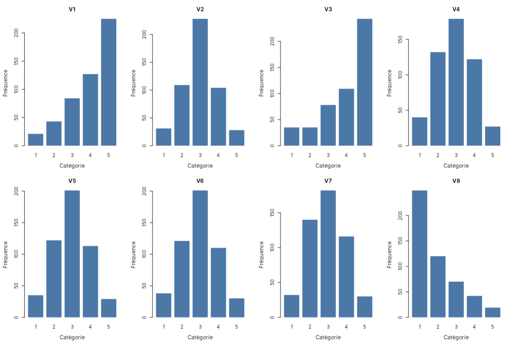
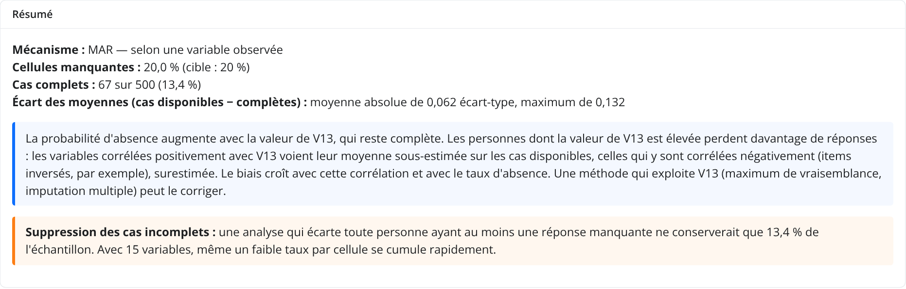

# Scénarios de génération {#sec-scenarios}

```{r}
#| include: false
source("_common.R")
biais_manquantes <- function(d) {
  (colMeans(d$response, na.rm = TRUE) - colMeans(d$response_complete)) / apply(d$response_complete, 2, sd)
}
mq <- lapply(c(mcar = "mcar", mar = "mar", mnar = "mnar"), function(m)
  generer(2024, missingness_mechanism = m, missingness_rate = 0.20))
bm <- lapply(mq, biais_manquantes)
cc <- sapply(mq, function(d) mean(stats::complete.cases(d$response)))
ancre <- mq$mar$missingness_mar_anchor
f_ancre <- mq$mar$factor_assignments[match(ancre, colnames(mq$mar$response))]
qd <- generer(2024, nfact = 2, vpf = 5L, group_sizes = c(1000L, 1000L), group_cov_diff = "high")
g_qd <- factor(qd$group_membership)
acc_qd <- c(lda = mean(MASS::lda(qd$response, g_qd, CV = TRUE)$class == g_qd),
            qda = mean(MASS::qda(qd$response, g_qd, CV = TRUE)$class == g_qd))
```

::: {.callout-tip title="Objectifs d'apprentissage"}
À la fin de ce chapitre, vous devriez être capable de :

- traduire un objectif méthodologique (AFE, CFA, MANOVA, LDA, QDA, corrélation canonique) en propriétés populationnelles concrètes à régler dans le générateur;
- justifier pourquoi une même population peut souvent servir à plusieurs analyses successives;
- appliquer le principe consistant à modifier une seule caractéristique à la fois pour isoler son effet;
- distinguer une démonstration ponctuelle, fondée sur un seul échantillon, d'une véritable étude de simulation méthodologique fondée sur des répétitions;
- retrouver, pour un scénario donné, l'onglet ou l'indicateur de l'application permettant de vérifier que la population a été construite comme prévu.
:::

::: {.callout-important title="Idée centrale"}
Une simulation utile part toujours d'une **propriété de population** recherchée — structure factorielle nette, covariance commune, relation entre facteurs, homogénéité ou hétérogénéité entre groupes — et non d'un bouton de l'application. Ce chapitre traduit systématiquement chaque question méthodologique courante en réglages concrets, dans les deux sens : de la question vers les paramètres, et des paramètres vers ce qu'on doit s'attendre à observer.
:::

::: {.callout-warning title="Pièges classiques"}
- Modifier plusieurs paramètres à la fois en croyant « rendre le scénario plus réaliste » : cela empêche ensuite d'attribuer un résultat observé à une cause précise.
- Croire qu'aucune configuration du générateur ne peut produire un modèle parallèle ou tau-équivalent exact — c'est possible dans un cas précis, précisé plus loin dans ce chapitre.
- Confondre une démonstration ponctuelle, réalisée sur un seul jeu de données, avec une étude de simulation méthodologique complète, qui exige des répétitions pour estimer un biais, une puissance ou un taux de couverture.
- Générer un nouveau jeu de données pour chaque méthode alors qu'une même population bien choisie sert souvent à plusieurs analyses complémentaires.
- Traiter les valeurs numériques proposées dans les recettes comme des règles universelles plutôt que comme des points de départ à adapter au problème étudié.
:::

Les chapitres précédents ont présenté plusieurs usages du générateur : analyse factorielle exploratoire, analyse factorielle confirmatoire, comparaisons multigroupes, MANOVA, classification discriminante et corrélation canonique. Le présent chapitre adopte une approche différente. Il rassemble ces possibilités sous forme de scénarios directement utilisables.

L'objectif n'est plus d'expliquer les méthodes elles-mêmes, mais de répondre à une question pratique :

> Quels réglages choisir dans l'application pour produire le type de données dont j'ai besoin ?

Chaque scénario suit la même logique : **objectif, réglages conseillés, structure attendue, analyse externe et éléments à observer**.

Les valeurs proposées ne constituent pas des règles universelles. Elles servent de points de départ cohérents que l'on peut ensuite modifier pour rendre le problème plus simple, plus difficile ou plus réaliste.

## Analyse factorielle exploratoire : structure claire

### Objectif

Produire un jeu de données dont la structure factorielle est nette et facilement récupérable par une AFE.

### Réglages conseillés

Une configuration simple peut comporter :

- 3 facteurs;
- 5 variables par facteur;
- charges principales fortes;
- aucune charge secondaire, ou très peu;
- corrélations factorielles faibles à modérées;
- distribution normale;
- un seul groupe;
- environ 500 observations.

### Structure attendue

La matrice de corrélations devrait présenter des blocs relativement clairs correspondant aux facteurs. Les variables appartenant au même facteur devraient être davantage corrélées entre elles qu'avec les variables appartenant aux autres facteurs.

La matrice de charges populationnelles fournit la structure exacte que l'AFE doit tenter de retrouver.

### Analyse externe

On peut effectuer une AFE dans R, SPSS, Stata ou un autre logiciel, choisir une méthode d'extraction appropriée et comparer plusieurs rotations.

Si les facteurs ont été générés comme corrélés, une rotation oblique constitue généralement un choix cohérent avec la population.

### À observer

On vérifiera principalement :

- le nombre de facteurs récupérés;
- l'association des variables aux bons facteurs;
- l'ordre de grandeur des charges estimées;
- la présence éventuelle de charges secondaires accidentelles;
- la stabilité de la solution.

Ce scénario constitue une bonne condition de référence avant de rendre progressivement la structure plus difficile.

## Analyse factorielle exploratoire : structure difficile

### Objectif

Créer une population dans laquelle la structure factorielle existe réellement, mais est plus difficile à récupérer.

### Réglages conseillés

On peut utiliser :

- 4 facteurs;
- 4 ou 5 variables par facteur;
- charges principales moyennes;
- charges secondaires présentes sur une proportion importante des variables;
- corrélations factorielles modérées;
- environ 150 à 250 observations;
- éventuellement une distribution asymétrique.

### Structure attendue

Les blocs de corrélations seront moins distincts et certaines variables pourront présenter des relations appréciables avec plusieurs facteurs. La structure populationnelle existe toujours, mais elle est moins simple.

### Analyse externe

Effectuez l'AFE avec les mêmes décisions analytiques que dans le scénario précédent afin de comparer les résultats dans deux populations de difficulté différente.

### À observer

Il est particulièrement intéressant d'examiner :

- les facteurs mal récupérés;
- les variables dont l'affectation devient ambiguë;
- l'effet des charges secondaires;
- les écarts entre population et échantillon;
- les conséquences d'une taille d'échantillon réduite.

L'intérêt de ce scénario est de montrer qu'une solution factorielle ambiguë ne signifie pas nécessairement que l'analyse a échoué. La population elle-même peut être difficile à représenter.

## CFA : modèle congénérique simple

### Objectif

Produire des données correspondant naturellement à un modèle de mesure congénérique.

### Réglages conseillés

Une configuration appropriée est :

- 1 facteur;
- 6 à 8 indicateurs;
- charges principales moyennes ou fortes;
- aucune charge secondaire;
- distribution normale;
- un seul groupe;
- 500 observations ou davantage.

### Structure attendue

Toutes les variables mesurent le même facteur, mais leurs charges ne sont pas identiques. Les variances résiduelles peuvent donc également différer.

Ce scénario correspond naturellement à un modèle congénérique plutôt qu'à un modèle parallèle ou strictement tau-équivalent.

### Analyse externe

Dans un logiciel CFA, spécifiez un facteur unique mesuré par l'ensemble des indicateurs et laissez les charges être estimées librement.

### À observer

Comparez :

- les charges estimées aux charges populationnelles;
- les variances résiduelles estimées;
- les indices d'ajustement;
- l'effet de la taille de l'échantillon sur la précision des estimations.

## CFA : comparer congénérique, tau-équivalent et parallèle

### Objectif

Montrer les conséquences de contraintes de mesure progressivement plus fortes.

### Réglages conseillés

Utilisez le même scénario congénérique à un facteur, avec plusieurs indicateurs et un grand échantillon, en choisissant des **charges principales Moyennes ou Élevées** (une plage, pas une valeur fixe).

Dans cette configuration, le générateur produit naturellement des charges différentes d'un indicateur à l'autre. Il ne génère donc pas exactement une population tau-équivalente ou parallèle.

### Structure attendue

Le modèle congénérique correspond le mieux à la population. Les modèles tau-équivalent et parallèle imposent des contraintes supplémentaires qui ne sont pas présentes dans le mécanisme générateur.

### Analyse externe

Ajustez successivement :

1. un modèle congénérique;
2. un modèle avec charges contraintes à l'égalité;
3. un modèle ajoutant des contraintes sur les variances résiduelles.

### À observer

Comparez les indices d'ajustement et les changements provoqués par chaque ensemble de contraintes.

Le but n'est pas seulement de déterminer quel modèle ajuste le mieux, mais de relier la détérioration de l'ajustement aux contraintes que nous savons être fausses dans la population.

::: {.callout-note title="Ceci suppose des charges variables"}
Cette conclusion vaut pour une population générée avec des charges principales tirées dans une plage (Faibles, Moyennes, Élevées ou Aléatoires). Le scénario suivant montre le cas inverse : une population où le parallélisme est exact.
:::

## CFA : modèle parallèle exact

### Objectif

Montrer le contrepoint du scénario précédent : une population où les contraintes du modèle parallèle sont réellement vraies, et où les imposer ne coûte donc rien.

### Réglages conseillés

Utilisez :

- 1 facteur;
- plusieurs indicateurs (6 à 8);
- charges principales **Fixe**, réglées sur une seule valeur;
- aucune charge secondaire;
- un seul groupe;
- 500 observations ou davantage.

### Structure attendue

Comme la variance de chaque facteur vaut 1 dans le groupe de référence, une charge principale fixe identique produit automatiquement la même communalité, et donc la même variance résiduelle, pour tous les indicateurs. La population est donc **strictement parallèle**, pas seulement approximativement homogène.

### Analyse externe

Ajustez les trois mêmes modèles que dans le scénario précédent : congénérique, tau-équivalent, parallèle.

### À observer

Contrairement au scénario congénérique, les trois modèles devraient ici produire des indices d'ajustement très proches les uns des autres : les contraintes supplémentaires imposées par les modèles tau-équivalent et parallèle ne coûtent rien puisqu'elles correspondent exactement à la structure génératrice.

::: {.callout-note title="Limite du générateur"}
Le générateur peut produire un modèle strictement parallèle ou tau-équivalent, mais seulement dans ce cas précis (charges principales Fixe, aucune charge secondaire). Il ne permet pas d'imposer une charge différente à un seul indicateur en particulier, ni de fixer individuellement chaque variance résiduelle : la structure obtenue est soit entièrement congénérique (charges en plage), soit entièrement parallèle (charge fixe), jamais un mélange construit sur mesure.
:::

## CFA : mauvaise spécification par omission de charges secondaires

### Objectif

Créer volontairement une situation où le modèle CFA ajusté ne correspond pas entièrement à la population.

### Réglages conseillés

Utilisez :

- 2 ou 3 facteurs;
- plusieurs indicateurs par facteur;
- charges principales moyennes ou fortes;
- quelques charges secondaires;
- corrélations factorielles modérées;
- échantillon d'au moins 400 ou 500 observations.

### Structure attendue

Certaines variables sont réellement liées à plus d'un facteur dans la population.

### Analyse externe

Ajustez d'abord un modèle CFA simple dans lequel toutes les charges secondaires sont fixées à zéro.

On peut ensuite libérer certaines charges correspondant à celles qui existent réellement dans la population.

### À observer

Examinez :

- la dégradation des indices d'ajustement;
- les résidus;
- les indices de modification, s'ils sont utilisés;
- l'amélioration du modèle lorsque les paramètres réellement présents sont réintroduits.

Ce scénario permet de relier directement le mauvais ajustement à une mauvaise spécification connue.

## CFA multigroupe : structure de mesure commune

### Objectif

Produire plusieurs groupes partageant la même structure de mesure mais pouvant différer sur leurs facteurs latents.

### Réglages conseillés

Utilisez par exemple :

- 3 facteurs;
- 4 ou 5 indicateurs par facteur;
- charges principales fortes;
- peu de charges secondaires;
- 2 ou 3 groupes;
- environ 200 observations par groupe;
- différences de moyennes nulles ou modérées;
- covariances égales.

### Structure attendue

Les charges sont communes aux groupes. Les différences observées dans les estimations de charges après analyse proviennent donc essentiellement de la fluctuation d'échantillonnage.

### Analyse externe

Ajustez une CFA multigroupe et examinez successivement :

- le modèle configurationnel;
- les contraintes d'égalité sur les charges;
- les différences de moyennes latentes si elles sont pertinentes.

### À observer

On peut comparer les modèles libres et contraints en sachant que l'égalité des charges est réellement présente dans la population.

Ce scénario constitue donc une bonne démonstration de l'invariance configurationnelle et métrique.

## CFA multigroupe : DIF scalaire ciblé

### Objectif

Montrer qu'une différence de moyenne observée peut provenir d'un indicateur non invariant plutôt que d'une différence sur le facteur latent.

### Réglages conseillés

Reprenez le scénario de structure de mesure commune, puis choisissez :

- 2 groupes;
- aucune différence de moyennes factorielles;
- covariances égales;
- soit des réponses continues avec **DIF d'intercept pour un item (G2)**, soit des réponses Likert avec **DIF de seuils pour un item (G2)**.

### Structure attendue

Les groupes ont les mêmes distributions latentes. Un seul item de `G2` fonctionne toutefois différemment : son intercept est plus élevé dans le cas continu, ou ses seuils rendent les catégories élevées moins accessibles dans le cas Likert.

### Analyse externe

Effectuez une CFA multigroupe. Comparez un modèle métrique à un modèle ajoutant les contraintes scalaires appropriées (intercepts pour les réponses continues, seuils pour les réponses ordinales).

### À observer

Une différence apparente sur un indicateur ne prouve pas à elle seule une différence de construit. Consultez ensuite le corrigé enseignant pour identifier le mécanisme effectivement introduit et distinguer cette information de ce qu'un étudiant devrait découvrir à partir des données.

## CFA multigroupe avec différences latentes

### Objectif

Créer des groupes qui mesurent les mêmes construits de la même manière, mais dont les niveaux latents diffèrent.

### Réglages conseillés

Conservez la structure du scénario précédent et choisissez :

- plusieurs groupes;
- différences de moyennes modérées ou fortes;
- covariances égales.

### Structure attendue

La structure de mesure reste commune, mais les moyennes des indicateurs changent parce que certains facteurs possèdent des moyennes différentes.

### Analyse externe

Effectuez une CFA multigroupe et examinez les différences latentes entre groupes.

### À observer

Il est particulièrement intéressant de comparer :

- les moyennes factorielles populationnelles;
- les moyennes observées par groupe;
- les estimations des différences latentes.

Ce scénario montre clairement qu'une mesure peut être comparable entre groupes sans que les groupes possèdent le même niveau sur le construit mesuré.

## MANOVA : absence d'effet

### Objectif

Créer une condition où l'hypothèse nulle de la MANOVA est vraie.

### Réglages conseillés

Utilisez :

- 2 ou 3 groupes;
- mêmes tailles de groupes;
- aucune différence de moyennes;
- covariances égales;
- distribution normale;
- plusieurs variables corrélées.

### Structure attendue

Les groupes possèdent le même vecteur de moyennes et la même structure de covariance. Les différences observées dans l'échantillon sont uniquement aléatoires.

### Analyse externe

Effectuez une MANOVA classique.

### À observer

Le résultat ne devrait pas être systématiquement significatif. En répétant plusieurs générations, il est possible d'observer directement la logique de l'erreur de type I : même lorsque l'hypothèse nulle est vraie, un résultat significatif peut occasionnellement apparaître.

## MANOVA : différence multivariée classique

### Objectif

Créer une situation favorable à une MANOVA classique.

### Réglages conseillés

Choisissez :

- 3 groupes;
- environ 150 à 250 observations par groupe;
- différences de moyennes modérées;
- covariances égales;
- distribution normale;
- plusieurs variables reliées.

### Structure attendue

Les groupes diffèrent par leur position dans l'espace multivarié mais partagent une structure de dispersion commune.

### Analyse externe

Effectuez la MANOVA puis, si elle est significative, examinez les analyses de suivi et les tailles d'effet.

### À observer

Comparez les résultats de Pillai, Wilks et des autres statistiques multivariées. Examinez également quelles variables reflètent le plus directement les différences introduites au niveau des facteurs.

## MANOVA : violation de l'homogénéité des covariances

### Objectif

Étudier une population dans laquelle les groupes diffèrent par leurs moyennes et leurs matrices de covariance.

### Réglages conseillés

Conservez le scénario précédent mais demandez :

- différences de moyennes modérées;
- différences de covariance modérées ou fortes.

On peut aussi utiliser des groupes de tailles différentes pour rendre la situation plus exigeante.

### Structure attendue

Les groupes possèdent à la fois des centres et des structures de dispersion différentes.

### Analyse externe

Effectuez la MANOVA et examinez également l'homogénéité des matrices de covariance, notamment à l'aide du test de Box lorsque celui-ci est disponible.

### À observer

Comparez les conclusions fournies par différentes statistiques multivariées et examinez dans quelle mesure l'hétérogénéité influence l'analyse.

## LDA : scénario idéal

### Objectif

Créer une population correspondant directement aux principales hypothèses structurelles de l'analyse discriminante linéaire.

### Réglages conseillés

Utilisez :

- 2 ou 3 groupes;
- groupes de taille semblable;
- différences de moyennes modérées;
- covariances égales;
- distribution normale.

### Structure attendue

Les groupes ont des centres différents mais la même matrice de covariance. La frontière de classification populationnelle est donc compatible avec une règle linéaire.

### Analyse externe

Effectuez une LDA à partir des variables générées et utilisez la variable `Groupe` comme catégorie à prédire.

### À observer

Examinez :

- les fonctions discriminantes;
- les centroïdes;
- la matrice de confusion;
- la précision globale;
- les résultats par groupe;
- la validation croisée.

Augmentez ensuite progressivement l'intensité des différences de moyennes pour observer comment la performance de classification change.

## LDA : classification difficile

### Objectif

Montrer qu'une différence réelle entre groupes ne garantit pas une bonne classification individuelle.

### Réglages conseillés

Choisissez :

- plusieurs groupes;
- faibles différences de moyennes;
- covariances égales;
- échantillon relativement grand.

### Structure attendue

Les populations diffèrent réellement, mais elles se chevauchent fortement.

### Analyse externe

Effectuez d'abord une MANOVA, puis une LDA sur les mêmes données.

### À observer

Avec un échantillon suffisamment grand, la MANOVA peut détecter une différence statistique tandis que la précision de classification demeure modeste.

Ce scénario permet d'illustrer une distinction essentielle :

> Une différence statistiquement détectable n'est pas nécessairement suffisamment importante pour permettre une prédiction individuelle précise.

## QDA : covariances différentes

### Objectif

Créer une situation dans laquelle les groupes ont des structures de covariance différentes.

### Réglages conseillés

Utilisez :

- 2 ou 3 groupes;
- différences de moyennes modérées;
- différences de covariance modérées ou fortes;
- taille raisonnable dans chaque groupe.

### Structure attendue

Les groupes diffèrent par leur centre et leur forme. Une frontière linéaire n'est donc plus nécessairement adaptée.

### Analyse externe

Ajustez à la fois une LDA et une QDA sur les mêmes données.

### À observer

Comparez leurs performances sur des données validées ou par validation croisée. La QDA correspond mieux au mécanisme populationnel, mais elle doit estimer davantage de paramètres.

En réduisant la taille des groupes, on peut montrer qu'un modèle plus flexible n'est pas toujours plus performant lorsque les données sont insuffisantes.

## QDA : même moyenne, covariance différente

### Objectif

Créer deux populations multivariées qui ne diffèrent pas par leur centre mais par leur dispersion.

### Réglages conseillés

Choisissez :

- 2 groupes;
- aucune différence de moyennes;
- différences de covariance fortes;
- taille de groupe suffisamment grande.

### Structure attendue

Les vecteurs de moyennes sont identiques :

$$
\boldsymbol{\mu}_1
=
\boldsymbol{\mu}_2,
$$

mais les matrices de covariance diffèrent :

$$
\boldsymbol{\Sigma}_1
\neq
\boldsymbol{\Sigma}_2.
$$

### Analyse externe

Comparez MANOVA, LDA et QDA.

### À observer

La MANOVA ne cible pas directement la différence de covariance. La LDA dispose de peu d'information liée aux centres. La QDA peut, au contraire, exploiter les différences de forme entre les distributions, mais seulement avec de grands groupes : avec 2 facteurs de 5 items, des covariances fortement différentes et 1 000 personnes par groupe (graine 2024), la LDA reste au hasard (`r pc(acc_qd["lda"], 1)` en validation croisée) alors que la QDA atteint `r pc(acc_qd["qda"], 1)`. Avec quelques dizaines de personnes par groupe, la QDA ne fait pas mieux que le hasard non plus (voir la @fig-lda-qda).

Ce scénario constitue une démonstration particulièrement claire du fait que deux populations multivariées peuvent être différentes même lorsqu'elles possèdent exactement les mêmes moyennes.

## Classification avec groupes déséquilibrés

### Objectif

Étudier l'effet de groupes de tailles très différentes sur l'évaluation d'une classification.

### Réglages conseillés

Utilisez par exemple :

- 2 groupes;
- 100 observations dans `G1`;
- 400 observations dans `G2`;
- différences de moyennes faibles ou modérées;
- covariances égales.

### Structure attendue

La classe majoritaire représente 80 % de l'échantillon.

### Analyse externe

Effectuez une LDA ou une autre méthode de classification et examinez à la fois la précision globale et les performances propres à chaque groupe.

### À observer

Une règle prédisant toujours `G2` obtiendrait déjà :

$$
\frac{400}{500}
=
80\%
$$

de précision.

Une classification de 82 % ne constitue donc pas nécessairement une performance impressionnante. La précision, le rappel et le score F1 de chaque groupe deviennent beaucoup plus informatifs.

## Corrélation canonique : deux blocs indépendants

### Objectif

Créer une condition de référence où deux ensembles de variables sont peu reliés.

### Réglages conseillés

Utilisez :

- 2 facteurs;
- plusieurs indicateurs par facteur;
- charges principales fortes;
- aucune charge secondaire;
- corrélation entre facteurs nulle ou très faible;
- un seul groupe;
- échantillon suffisamment grand.

Après génération, les indicateurs du premier facteur constituent le bloc $\mathbf{X}$ et ceux du second le bloc $\mathbf{Y}$.

### Structure attendue

Les deux ensembles possèdent peu de relation populationnelle systématique.

### Analyse externe

Effectuez une analyse de corrélation canonique.

### À observer

Une corrélation canonique non nulle apparaîtra généralement malgré l'absence de relation substantielle, parce que la procédure maximise la corrélation dans l'échantillon.

Répétez la simulation avec différentes tailles d'échantillon afin d'observer la stabilité de ces relations accidentelles.

## Corrélation canonique : relation entre deux blocs

### Objectif

Créer deux ensembles de variables possédant une relation populationnelle connue.

### Réglages conseillés

Conservez :

- 2 facteurs;
- 4 à 6 indicateurs par facteur;
- charges principales fortes;
- aucune charge secondaire;
- corrélation factorielle modérée;
- un échantillon d'environ 500 observations.

### Structure attendue

Les variables de chaque bloc représentent principalement leur propre facteur, tandis que la relation entre les deux blocs provient de la corrélation entre les facteurs.

### Analyse externe

Utilisez les variables du premier facteur comme bloc $\mathbf{X}$ et celles du second comme bloc $\mathbf{Y}$.

### À observer

Examinez :

- la première corrélation canonique;
- les coefficients canoniques;
- les corrélations de structure;
- les corrélations croisées;
- la redondance.

Comparez les variables les plus importantes dans la solution aux charges factorielles populationnelles.

## Corrélation canonique : qualité de mesure

### Objectif

Distinguer la force de la relation entre deux construits de la qualité des variables qui les mesurent.

### Réglages conseillés

Générez deux scénarios avec la même corrélation entre facteurs.

Dans le premier :

- charges principales fortes.

Dans le second :

- charges principales plus faibles.

Tous les autres paramètres restent identiques.

### Structure attendue

La relation latente entre les facteurs est la même dans les deux populations, mais les variables observées représentent moins précisément les facteurs dans le second scénario.

### Analyse externe

Effectuez la même analyse canonique sur les deux jeux de données.

### À observer

Comparez la force et la stabilité de la relation canonique. Cette expérience montre qu'une relation substantielle entre construits peut être difficile à observer lorsque les mesures utilisées pour les représenter sont peu précises.

## Effet de la taille de l'échantillon

### Objectif

Observer la fluctuation d'échantillonnage indépendamment de la méthode statistique utilisée.

### Réglages conseillés

Choisissez une structure populationnelle, générez-la avec une graine fixe, puis tirez successivement, avec le bouton **Nouvel échantillon, même population**, des échantillons de taille :

$$
N=50,
$$

$$
N=200,
$$

$$
N=500
$$

et :

$$
N=2000.
$$

Changez la taille du groupe avant chaque clic et ne modifiez aucun autre réglage.

### Structure attendue

La population reste exactement la même, mais les matrices observées deviennent progressivement plus stables.

### Analyse externe

Le même principe peut être appliqué à l'AFE, à la CFA, à la MANOVA, à la classification ou à la corrélation canonique.

### À observer

Examinez d'abord l'onglet **Vérification**, puis comparez la stabilité des estimations produites par la méthode choisie.

Ce scénario permet d'isoler clairement l'effet de la taille de l'échantillon.

## Effet de la non-normalité

### Objectif

Comparer une condition distributionnelle favorable à une condition plus asymétrique sans changer la structure multivariée fondamentale.

### Réglages conseillés

Construisez d'abord un scénario avec une distribution normale. Reproduisez ensuite une configuration semblable en choisissant une distribution asymétrique.

Conservez autant que possible :

- le nombre de facteurs;
- le nombre de variables;
- les charges;
- les corrélations;
- les groupes;
- la taille de l'échantillon.

### Structure attendue

La structure factorielle fondamentale demeure présente, mais les distributions marginales des variables deviennent moins proches de la normale.

### Analyse externe

Ce scénario peut être appliqué à pratiquement toutes les méthodes présentées dans les chapitres précédents.

### À observer

Comparez les estimations, les diagnostics et la stabilité des résultats. L'objectif n'est pas de chercher une frontière universelle entre « normal » et « non normal », mais d'étudier la sensibilité de la méthode dans une population contrôlée.

## Réponses Likert et styles de réponse

### Objectif

Observer ce qui change lorsque des réponses continues sous-jacentes sont codées en catégories ordinales et que certains répondants utilisent l'échelle d'une manière systématique.

### Réglages conseillés

Créez d'abord une structure à trois facteurs claire. Reproduisez-la ensuite avec :

- des réponses Likert à 5 catégories, puis à 2 et à 7 catégories;
- des profils de seuils variés par item;
- 15 % de répondants présentant, à tour de rôle, une tendance au milieu, aux extrêmes ou à l'acquiescement.

Gardez la même graine pour comparer les conditions aussi directement que possible.

### À observer

Comparez les distributions d'items et les corrélations de Pearson. Dans l'onglet **Vérification**, passez de **Réponses continues initiales** à **Données finales (Pearson)**, puis à **Données finales (polychoriques)** : l'écart moyen signé mesure l'atténuation due au codage, puis sa correction [@Olsson1979]. Dans une analyse externe, comparez si possible une analyse fondée sur Pearson à une analyse utilisant des corrélations polychoriques [@Rhemtulla2012]. Le but n'est pas de déclarer une méthode universellement meilleure, mais de relier le choix de l'analyse à la nature des réponses.

{#fig-cap-likert-distributions .capture width="92%"}

```{r}
#| label: fig-attenuation
#| cache: true
#| fig-cap: "Rapport moyen entre la corrélation observée et la corrélation populationnelle (fil rouge, N = 2 000, graine 2024) selon le nombre de catégories Likert et le profil des seuils. Les corrélations de Pearson calculées sur les codes sont d'autant plus atténuées que les catégories sont peu nombreuses et les seuils asymétriques; les corrélations polychoriques restent proches de la population."
#| fig-height: 3.6
att <- do.call(rbind, lapply(c("balanced", "low"), function(pr) {
  do.call(rbind, lapply(2:7, function(k) {
    d <- generer(2024, group_sizes = 2000L, response_format = "likert", likert_categories = k, likert_profile = pr)
    S <- d$population_correlation; kk <- lower.tri(S)
    Rp <- cor(d$response); Rc <- suppressWarnings(suppressMessages(psych::polychoric(d$response, correct = 0)$rho))
    data.frame(profil = if (pr == "balanced") "Seuils équilibrés" else "Seuils surtout bas", K = k,
               type = c("Pearson sur les codes", "Polychorique"),
               ratio = c(mean(Rp[kk] / S[kk]), mean(Rc[kk] / S[kk])))
  }))
}))
ggplot(att, aes(K, ratio, colour = type, linetype = profil)) + geom_line(linewidth = 1.05) + geom_point(size = 2) +
  geom_hline(yintercept = 1, colour = "grey40") +
  scale_colour_manual(values = c(pal$orange, pal$bleu), name = NULL) +
  scale_linetype_manual(values = c("solid", "dashed"), name = NULL) +
  scale_x_continuous(breaks = 2:7) + scale_y_continuous(labels = axe_fr) +
  labs(x = "Nombre de catégories", y = "Corrélation observée / populationnelle") +
  guides(colour = guide_legend(nrow = 2), linetype = guide_legend(nrow = 2))
```

Avec des réponses dichotomiques équilibrées, les corrélations de Pearson ne représentent qu'environ `r pc(att$ratio[att$K == 2 & att$type == "Pearson sur les codes" & att$profil == "Seuils équilibrés"], 0)` des corrélations populationnelles; avec 7 catégories, environ `r pc(att$ratio[att$K == 7 & att$type == "Pearson sur les codes" & att$profil == "Seuils équilibrés"], 0)`. Les corrélations polychoriques corrigent l'essentiel de cette atténuation, quel que soit le nombre de catégories.

## Items inversés et acquiescement

### Objectif

Montrer pourquoi les questionnaires mélangent des items directs et inversés, et ce que l'acquiescement fait aux corrélations.

### Réglages conseillés

Partez du préréglage **Sondage Likert** (4 échelles de 6 items en 7 points, environ un tiers d'items inversés, 15 % d'acquiescement, 10 % de données manquantes MAR), ou de la population fil rouge avec **Items à formulation inversée : environ un tiers**, réponses Likert et **Style de réponse : Acquiescement**.

### Structure attendue

Les items inversés ont des charges négatives (colonne **Sens** de **Structure des variables**). L'acquiescement ajoute aux répondants concernés une même constante sur tous les items, directs ou inversés : il crée une source de variance commune à tous les items, étrangère aux facteurs [@Baumgartner2001].

### Analyse externe

Recodez les items inversés (le codebook du paquet étudiant les signale), calculez les scores d'échelle et leurs alphas, puis réalisez une AFE avec et sans recodage.

### À observer

Sans recodage, les items inversés corrèlent négativement avec leur échelle et l'alpha s'effondre. Dans **Vérification** (données finales, polychoriques), comparez l'écart moyen signé avec et sans acquiescement : le style ajoute une covariance positive à toutes les paires, ce qui rapproche de zéro les corrélations négatives entre items directs et inversés et gonfle les autres.

## Structure bifactorielle : un score total est-il justifié?

### Objectif

Produire des données où un score total et des sous-échelles coexistent, et juger si le score total est essentiellement unidimensionnel.

### Réglages conseillés

Utilisez le préréglage **Détresse psychologique** (facteur général et 3 facteurs spécifiques de 6 items), puis faites varier **Charges sur le facteur général** de faibles à élevées.

### Structure attendue

Le sous-onglet **Fidélité populationnelle** donne, pour chaque population, le ω hiérarchique et l'ECV : plus les charges générales sont élevées, plus le score total mesure le facteur général.

### Analyse externe

Ajustez un modèle à facteurs corrélés, un modèle à un facteur et un modèle bifactoriel (syntaxe dans `modele_lavaan.R`); calculez $\omega_h$ à partir de la solution estimée et comparez-le à la valeur populationnelle.

### À observer

Avec des charges générales faibles, le score total reste fidèle mais mesure un mélange de dimensions; avec des charges générales élevées, un modèle à un facteur devient presque acceptable [@Rodriguez2016].

## Données manquantes : trois mécanismes à distinguer

### Objectif

Montrer que le même taux de valeurs manquantes ne décrit pas nécessairement le même problème analytique.

### Réglages conseillés

À partir d'une même structure continue ou Likert, conservez la graine et comparez trois versions comportant 20 % de données manquantes : MCAR, MAR et MNAR. Le sous-onglet **Données → Données manquantes** montre aussitôt les conséquences de chaque mécanisme.

### Analyse externe

Commencez par décrire l'ampleur et le patron des absences. Comparez ensuite, selon les possibilités du logiciel, une analyse par cas complets à une stratégie d'imputation ou d'estimation qui exploite l'information disponible.

### À observer

Le fichier étudiant indique la présence de valeurs manquantes sans révéler leur mécanisme. Après l'exercice, le corrigé enseignant, qui contient les données complètes avant suppression, permet de relier les difficultés rencontrées au mécanisme réellement simulé. Le contraste est particulièrement utile : MAR est fondé sur une information observée, tandis que MNAR dépend d'une information qui devient précisément indisponible [@Rubin1976; @Enders2010].

{#fig-cap-manquantes-resume .capture width="92%"}

```{r}
#| label: fig-biais-manquantes
#| fig-cap: "Écart entre la moyenne calculée sur les cas disponibles et la moyenne des données complètes, en écarts-types, pour les 15 items du fil rouge avec 20 % de cellules manquantes (graine 2024). Sous MAR, la variable auxiliaire (complète) et les items de son facteur sont signalés."
#| fig-height: 3.6
bd <- do.call(rbind, lapply(names(bm), function(m) data.frame(meca = toupper(m), item = names(bm[[m]]),
  facteur = paste0("F", mq[[m]]$factor_assignments), ecart = bm[[m]])))
bd$meca <- factor(bd$meca, levels = c("MCAR", "MAR", "MNAR"))
bd$groupe <- ifelse(bd$meca == "MAR" & bd$facteur == paste0("F", f_ancre), "Même facteur que la variable auxiliaire", "Autres items")
bd$groupe[bd$meca == "MAR" & bd$item == ancre] <- "Variable auxiliaire (complète)"
ggplot(bd, aes(meca, ecart, colour = groupe)) +
  geom_hline(yintercept = 0, colour = "grey50") +
  geom_jitter(width = 0.15, height = 0, size = 2.3, alpha = 0.85) +
  scale_colour_manual(values = c("Autres items" = "grey45", "Même facteur que la variable auxiliaire" = pal$orange,
                                 "Variable auxiliaire (complète)" = pal$bleu), name = NULL) +
  scale_y_continuous(labels = axe_fr) +
  labs(x = NULL, y = "Biais de la moyenne (en écarts-types)") +
  guides(colour = guide_legend(nrow = 2))
```

La @fig-biais-manquantes résume la différence entre les trois mécanismes. Sous MCAR, les moyennes des cas disponibles restent sans biais. Sous MAR, la variable auxiliaire est ici `r ancre`; les items de son facteur, qui lui sont fortement corrélés, perdent surtout leurs valeurs élevées et leurs moyennes sont sous-estimées, tandis que les autres items ne sont que légèrement touchés. Sous MNAR, tous les items sont sous-estimés d'environ `r fr(abs(mean(bm$mnar)), 2)` écart-type. Dans les trois cas, avec 15 items et 20 % de cellules manquantes, il ne reste que `r pc(cc["mcar"], 1)` à `r pc(max(cc), 1)` de cas complets.

## Effet des groupes de tailles différentes

### Objectif

Étudier les conséquences du déséquilibre des effectifs tout en conservant les propriétés des populations.

### Réglages conseillés

Comparez par exemple :

**Condition équilibrée**

$$
n_1=n_2=n_3=200
$$

et :

**Condition déséquilibrée**

$$
n_1=100,\qquad
n_2=200,\qquad
n_3=300.
$$

Les différences de moyennes et de covariance demeurent inchangées.

### Structure attendue

Les populations sont identiques entre les deux expériences. Seule la quantité d'information disponible dans chaque groupe change.

### Analyse externe

Ce scénario est particulièrement utile pour la MANOVA, la CFA multigroupe, la LDA et la QDA.

### À observer

Examinez la précision des estimations propres à chaque groupe ainsi que l'influence éventuelle du déséquilibre sur les tests ou les performances de classification.

## Construire ses propres scénarios

Les scénarios précédents ne représentent qu'une petite partie des possibilités. Le principe général consiste à identifier d'abord la propriété populationnelle nécessaire à la question étudiée, puis à déterminer quels contrôles du générateur permettent de la créer.

On peut résumer cette logique de la manière suivante.

| Question | Propriété à manipuler |
|---|---|
| Récupération d'une structure factorielle | Charges, charges secondaires, corrélations factorielles |
| Précision des estimations | Taille de l'échantillon |
| CFA mal spécifiée | Charges secondaires omises ou contraintes excessives |
| Comparaison multigroupe | Moyennes et covariances factorielles |
| MANOVA | Différences de moyennes entre groupes |
| LDA | Moyennes différentes et covariance commune |
| QDA | Covariances différentes entre groupes |
| Corrélation canonique | Relations entre facteurs associés à différents blocs |
| Robustesse distributionnelle | Distribution normale ou asymétrique |
| Réponses ordinales | Codage Likert, profils de seuils et corrélations adaptées |
| Invariance scalaire | DIF d'intercept ou de seuils entre groupes |
| Données manquantes | Mécanisme MCAR, MAR ou MNAR et stratégie de traitement |
| Fidélité et tau-équivalence | Charges fixes ou en plage; comparer α et ω |
| Score total ou sous-échelles | Structure bifactorielle et charges sur le facteur général |
| Recodage des items | Items à formulation inversée, acquiescement |

Cette manière de raisonner est plus importante que les valeurs numériques proposées dans les recettes. Une simulation utile commence par une **propriété de population** et non par un bouton de l'application.

## Modifier une chose à la fois

Pour comprendre l'effet d'une caractéristique, il est généralement préférable de comparer des scénarios qui ne diffèrent que par un paramètre conceptuellement important.

Si l'objectif est d'étudier l'effet des charges secondaires, conservez la même taille d'échantillon, les mêmes corrélations factorielles et la même distribution. Si l'objectif est d'étudier l'hétérogénéité des covariances, conservez les mêmes différences de moyennes et les mêmes tailles de groupes.

Une comparaison dans laquelle cinq propriétés changent simultanément peut produire des données intéressantes, mais elle permet rarement de comprendre pourquoi les résultats ont changé.

## Passer d'une démonstration à une petite étude de simulation

Les scénarios de ce chapitre utilisent généralement un seul échantillon à la fois. Ils sont conçus avant tout pour l'apprentissage, la démonstration et la création de jeux de données destinés à une analyse externe.

Une véritable étude de simulation méthodologique va plus loin. Elle répète chaque condition un grand nombre de fois afin d'étudier la distribution des résultats : biais, erreur quadratique moyenne, taux de couverture, puissance, taux d'erreur, stabilité des solutions ou performance prédictive.

Le générateur interactif n'a pas été conçu pour automatiser des milliers de réplications. Sa fonction est plutôt de permettre de **concevoir et comprendre une population** avant de passer, si nécessaire, à un programme de simulation spécialisé.

Cette distinction garde l'application légère tout en lui donnant un rôle très utile dans la préparation d'études plus complexes.

## Une même population peut servir plusieurs fois

Il n'est pas nécessaire de générer un jeu de données différent pour chaque méthode. Au contraire, analyser la même population sous plusieurs perspectives constitue souvent l'un des exercices les plus instructifs.

Un jeu de données comprenant trois groupes, des différences de moyennes et des covariances égales peut servir à une CFA multigroupe, à une MANOVA et à une LDA. Si les covariances deviennent différentes, les mêmes données peuvent également servir à comparer LDA et QDA.

De la même manière, une structure à plusieurs facteurs peut être étudiée par AFE, puis par CFA, ou être réorganisée en deux blocs pour une analyse canonique.

Ce sont les **questions** qui changent, pas nécessairement les données.

## Du générateur à l'analyse

Le parcours général peut donc être résumé ainsi :

1. définir la question statistique;
2. identifier les propriétés que la population doit posséder;
3. régler le générateur;
4. examiner la structure populationnelle;
5. générer et vérifier l'échantillon;
6. exporter les données;
7. effectuer l'analyse dans le logiciel choisi;
8. comparer les résultats à la population connue.

Cette dernière étape est ce qui distingue profondément l'utilisation de données simulées d'une analyse de données ordinaires. Nous ne demandons pas seulement ce que les résultats semblent indiquer; nous pouvons vérifier ce qui était réellement vrai avant même l'analyse.

## Le générateur comme laboratoire multivarié

Au départ, le modèle factoriel peut donner l'impression que l'application est principalement destinée à l'analyse factorielle. Les scénarios de ce chapitre montrent une perspective beaucoup plus générale.

La matrice de charges permet de construire des ensembles de variables possédant une structure cohérente. Les corrélations entre facteurs contrôlent une partie des relations entre ces ensembles. Les moyennes factorielles permettent de déplacer des groupes dans l'espace multivarié, tandis que les matrices de covariance factorielles permettent de modifier leur dispersion et leurs relations internes.

À partir de ces quelques mécanismes, on peut produire des données adaptées à un ensemble très large de méthodes classiques.

Le modèle factoriel n'est donc pas nécessairement l'analyse finale. Il constitue le **moteur de construction de la population**.

Le dernier appendice décrira précisément ce moteur. Nous y reviendrons sur les équations utilisées pour construire les charges, les communalités, les variances résiduelles, les matrices de covariance, les scores factoriels, les distributions non normales et les populations multigroupes. Cette partie n'est pas nécessaire pour utiliser l'application, mais elle permettra au lecteur qui le souhaite de savoir exactement **comment les données sont produites derrière l'interface**.

::: {.callout-note title="🖥️ Dans l'application"}
- Les **préréglages** fournissent des points de départ; chaque recette de ce chapitre peut ensuite être ajustée carte par carte.
- **Nouvel échantillon, même population** transforme une démonstration en petite série d'échantillons d'une même population.
- **Données → Données manquantes**, **Structure populationnelle → Fidélité populationnelle** et **Vérification** permettent de vérifier, avant toute analyse externe, que la population possède les propriétés voulues.
- Pour un exercice, fixez la graine, distribuez le **paquet étudiant** et conservez le **corrigé enseignant**.
:::

## Laboratoire : trois mécanismes, un même taux {#sec-labo-10}

Générez la population fil rouge (graine **2024**) avec **20 %** de données manquantes, successivement **MCAR**, **MAR** et **MNAR**. Pour chaque version, consultez **Données → Données manquantes**.

1. Le taux de cellules manquantes et le pourcentage de cas complets diffèrent-ils d'un mécanisme à l'autre?
2. Quel mécanisme biaise toutes les moyennes? Lequel n'en biaise que certaines?
3. Sous MAR, quelle variable reste complète et pourquoi les items `r paste0("V", range(which(mq$mar$factor_assignments == f_ancre)), collapse = " à ")` sont-ils les plus touchés?

::: {.callout-tip title="Réponse" collapse="true"}
1. Le taux de cellules manquantes est le même (20 %), mais pas le pourcentage de cas complets : `r pc(cc["mcar"], 1)` sous MCAR, `r pc(cc["mar"], 1)` sous MAR et `r pc(cc["mnar"], 1)` sous MNAR. MCAR disperse les cellules vides uniformément entre les personnes; MAR les concentre sur les personnes dont la valeur de la variable auxiliaire est élevée, ce qui laisse davantage de personnes intactes. Le taux d'absence ne dit donc rien du mécanisme, mais le patron des absences, lui, en dit quelque chose.
2. MNAR biaise toutes les moyennes (écart moyen de `r fr(mean(bm$mnar), 3)` écart-type). MAR biaise surtout les items corrélés à la variable auxiliaire (jusqu'à `r fr(min(bm$mar), 3)` écart-type); MCAR ne biaise rien (écarts entre `r fr(min(bm$mcar), 3)` et `r fr(max(bm$mcar), 3)`).
3. La variable auxiliaire est `r ancre`. Les personnes dont la valeur de `r ancre` est élevée perdent davantage de réponses. Les items du même facteur sont fortement corrélés à `r ancre` : ils perdent donc surtout leurs valeurs élevées. Comme `r ancre` est observée, une méthode qui l'exploite (maximum de vraisemblance à information complète, imputation multiple) peut corriger ce biais; ce n'est pas possible sous MNAR.
:::

::: {.callout-important title="À retenir"}
- Une bonne recette part d'une propriété de population, puis la traduit en réglages.
- Changer une seule caractéristique à la fois; garder la graine, ou tirer un nouvel échantillon de la même population.
- Une démonstration utilise un échantillon; une étude de simulation répète chaque condition.
- Codage Likert, items inversés, styles de réponse et données manquantes sont des transformations contrôlées : l'application les documente toutes dans le corrigé enseignant.
:::

## Erreurs fréquentes

| Erreur | Ce qu'il faut retenir |
|---|---|
| Modifier plusieurs paramètres à la fois pour comprendre un effet | Isoler une seule caractéristique à la fois pour pouvoir lui attribuer un résultat observé |
| Croire qu'un modèle parallèle ou tau-équivalent exact est impossible à générer | Charges principales Fixe avec aucune charge secondaire produit une structure strictement parallèle |
| Générer un nouveau jeu de données pour chaque méthode | Une même population (par exemple moyennes différentes, covariances égales) sert souvent à plusieurs analyses complémentaires |
| Traiter les recettes comme des règles universelles | Ce sont des points de départ cohérents, à adapter selon l'objectif pédagogique poursuivi |
| Confondre une démonstration ponctuelle et une étude de simulation | Une seule génération illustre un mécanisme; une étude méthodologique complète exige des répétitions |

## Quiz

::: {.callout-note title="Question 1 — numérique" collapse="true"}
Le scénario « Effet de la taille de l'échantillon » propose de comparer $N=50$, $N=200$, $N=500$ et $N=2000$ sur une même population. Par quel facteur l'erreur-type d'une corrélation diminue-t-elle entre le plus petit et le plus grand de ces échantillons?

**Réponse : environ 6,3.** L'erreur-type varie comme $1/\sqrt{N}$; le rapport des tailles vaut $2000/50 = 40$, et $\sqrt{40} \approx 6{,}3$.
:::

::: {.callout-note title="Question 2 — vrai ou faux" collapse="true"}
Vrai ou faux : le générateur actuel peut produire une population strictement parallèle en réglant les charges principales sur **Fixe** avec une seule valeur et en désactivant les charges secondaires.

**Réponse : Vrai.** La variance de chaque facteur valant 1 dans le groupe de référence, une charge principale fixe identique produit automatiquement la même communalité — et donc la même variance résiduelle — pour tous les indicateurs.
:::

::: {.callout-note title="Question 3 — vrai ou faux" collapse="true"}
Vrai ou faux : il faut généralement générer un jeu de données différent pour chaque méthode multivariée que l'on souhaite illustrer (AFE, MANOVA, LDA, etc.).

**Réponse : Faux.** Une même population bien choisie — par exemple plusieurs groupes avec différences de moyennes et covariances égales — peut servir successivement à une CFA multigroupe, une MANOVA et une LDA.
:::

::: {.callout-note title="Question 4 — diagnostic de scénario" collapse="true"}
Vous voulez démontrer que la QDA améliore la classification par rapport à la LDA **uniquement** grâce à une différence de covariance entre groupes, et non à cause d'une différence de moyennes. Quelles propriétés devez-vous régler, et que devez-vous garder identique entre les deux modèles comparés?

**Réponse :** Il faut générer une population sans différence de moyennes factorielles (option « Aucune ») mais avec une différence de covariance marquée (« Variations fortes »), afin que les centres des groupes coïncident et que seule leur dispersion diffère. La taille des groupes, le nombre de facteurs, les charges et la distribution doivent rester identiques entre les deux ajustements. On applique ensuite LDA et QDA sur exactement les mêmes données : toute différence de performance observée provient alors uniquement de la capacité de QDA à exploiter des covariances propres à chaque groupe, puisque l'information de moyenne est absente par construction.
:::
