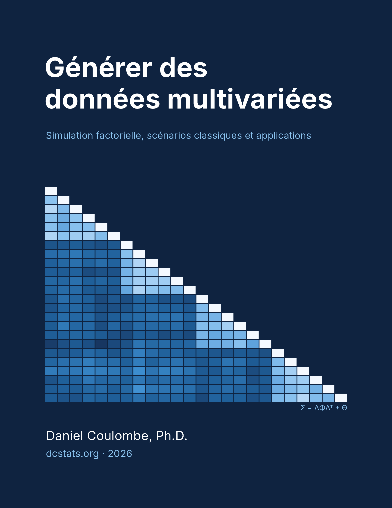

# Préface {.unnumbered}

::: {.content-visible when-format="html"}
{fig-align="center" width="60%" fig-alt="Couverture du manuel Générer des données multivariées"}
:::

::: {.callout-tip title="Application compagnon"}
Ce manuel accompagne [**MultvarGen**](https://shiny.dcstats.org/MultvarGen){target="_blank"}, une application interactive permettant de générer des données multivariées à partir de structures factorielles connues, puis d'examiner les données obtenues et leur structure populationnelle.

[Ouvrir MultvarGen](https://shiny.dcstats.org/MultvarGen){.btn .btn-primary target="_blank"}
:::

Les méthodes multivariées sont souvent présentées à partir de jeux de données existants. Cette approche est indispensable, mais elle ne permet pas toujours de voir clairement comment les propriétés d'une population influencent les résultats obtenus dans un échantillon. La simulation offre une autre perspective : on définit d'abord la population, on génère ensuite des observations à partir de cette population, puis on examine ce que les méthodes statistiques permettent d'en retrouver.

Le générateur présenté dans ce manuel permet de créer des jeux de données multivariés à partir d'une structure factorielle connue. L'utilisateur contrôle notamment :

- le nombre de facteurs et d'indicateurs, l'importance des charges principales et secondaires, la proportion d'items à formulation inversée et les relations entre facteurs;
- le type de structure : facteurs corrélés ou structure bifactorielle (un facteur général et des facteurs spécifiques);
- la distribution des variables et le format des réponses, continu ou Likert de 2 à 7 catégories;
- le nombre et la taille des groupes, ainsi que leurs différences de moyennes et de covariances factorielles.

Des styles de réponse, des violations ciblées de l'invariance de mesure et plusieurs mécanismes de données manquantes (MCAR, MAR, MNAR) peuvent également être introduits à des fins pédagogiques. Pour chaque jeu généré, l'application donne la structure vraie, la fidélité exacte de chaque échelle et une comparaison entre la population et l'échantillon.

L'objectif n'est cependant pas seulement de produire des données destinées à l'analyse factorielle. Une structure factorielle constitue également un moyen particulièrement souple de générer des ensembles de variables corrélées. Les données obtenues peuvent ainsi servir à illustrer et à étudier plusieurs méthodes multivariées classiques : analyse factorielle exploratoire et confirmatoire, analyses multigroupes, MANOVA, classification discriminante linéaire ou quadratique et corrélation canonique.

## À qui s'adresse ce manuel? {#sec-public}

Le manuel s'adresse aux étudiantes et étudiants des cycles supérieurs qui apprennent les méthodes multivariées, ainsi qu'aux personnes qui les enseignent et souhaitent préparer des jeux de données pour un cours, un travail pratique, un examen ou une démonstration. À la fin du parcours, vous devriez pouvoir :

- traduire une question méthodologique en propriétés de population : structure factorielle nette ou ambiguë, groupes séparés par leurs moyennes ou par leurs covariances, blocs de variables reliés, réponses ordinales, données incomplètes;
- régler l'application pour produire exactement ces propriétés, et vérifier qu'elles sont bien présentes;
- distinguer, dans un résultat d'analyse, ce qui relève de la population, de la fluctuation d'échantillonnage et de la méthode;
- préparer un jeu de données reproductible, accompagné d'un paquet étudiant et d'un corrigé enseignant.

## Deux façons d'utiliser ce manuel {#sec-deux-facons}

Les premiers chapitres expliquent le fonctionnement général du générateur et l'utilisation de l'application. Ils présentent les réglages de simulation, les données produites, la structure populationnelle et la comparaison entre population et échantillon.

La seconde partie du manuel adopte une approche différente. Elle part non plus des contrôles de l'application, mais de **scénarios d'analyse**. Pour chaque méthode, nous verrons comment configurer le générateur afin de produire des données présentant les caractéristiques recherchées, ce que ces réglages impliquent au niveau de la population et ce que l'on devrait retrouver dans les analyses réalisées ensuite.

Cette approche permet d'utiliser le générateur comme un véritable laboratoire de statistique multivariée.

## Organisation du manuel {#sec-organisation}

Le chapitre 1 présente le modèle statistique général et les principaux paramètres qui déterminent les données produites. Le chapitre 2 décrit l'application elle-même et le rôle de ses différents contrôles. Le chapitre 3 examine la relation entre population et échantillon, notamment la fluctuation des moyennes, variances et corrélations observées autour de leurs valeurs populationnelles.

Les chapitres 4 à 9 sont consacrés à des familles de scénarios : analyse factorielle exploratoire, analyse factorielle confirmatoire, données multigroupes, MANOVA, classification discriminante et corrélation canonique. Ils peuvent être lus dans l'ordre qui convient à votre cours. Le chapitre 10 rassemble des recettes de simulation directement reproductibles dans l'application, y compris pour les réponses ordinales, les items inversés, les structures bifactorielles et les données manquantes.

Un glossaire rassemble les définitions des principaux termes. Enfin, un appendice technique décrit en détail le moteur de génération : les lecteurs qui souhaitent comprendre précisément comment les matrices de charges, les scores factoriels, les composantes résiduelles, les structures multigroupes, les réponses ordinales et les données manquantes sont construits y trouveront les équations et les étapes de calcul correspondantes.

## Un fil rouge reproductible {#sec-fil-rouge}

Un même jeu de données sert de **fil rouge** dans plusieurs chapitres : trois facteurs corrélés à 0,30, cinq items par facteur, des charges principales élevées, aucune charge secondaire, 500 personnes et la graine **2024**. Avec ces réglages, l'application reproduit exactement les nombres cités dans le texte. Les figures du manuel sont produites avec le moteur de l'application lui-même : elles montrent donc ce que vous obtiendrez en reproduisant les réglages indiqués. Les captures d'écran, encadrées d'un trait gris, montrent l'interface telle qu'elle se présente.

## Comment lire les encadrés {#sec-encadres}

Chaque chapitre suit la même organisation.

- **Objectifs d'apprentissage** et **Idée centrale** annoncent ce qui compte.
- **Pièges classiques** signale les erreurs de raisonnement les plus fréquentes.
- Les encadrés **🖥️ Dans l'application** indiquent les gestes précis à faire dans MultvarGen.
- Un **laboratoire** propose une petite expérience à réaliser dans l'application; sa réponse est repliée sous l'énoncé.
- **À retenir** résume ce qu'il faut emporter du chapitre.
- Un **quiz** à réponses repliées permet de vérifier sa compréhension.

## Une application de génération, non d'analyse {#sec-generation}

L'application est volontairement centrée sur la **génération et l'inspection des données**. Elle permet de connaître la population dont proviennent les observations et d'en examiner les principales propriétés, mais elle ne cherche pas à remplacer les logiciels consacrés aux analyses multivariées.

Les jeux de données et les matrices produites peuvent être exportés puis analysés dans R, SPSS, Stata, AMOS ou d'autres environnements statistiques. Le corrigé enseignant contient même une syntaxe `lavaan` du modèle qui a servi à générer les données. Cette séparation entre génération et analyse permet de comparer les résultats obtenus par différentes méthodes tout en connaissant exactement les propriétés de la population ayant servi à produire les données.

::: {.callout-note title="Une habitude à prendre"}
Avant d'analyser des données simulées, ouvrez toujours l'onglet **Structure populationnelle**. C'est le corrigé : il vous dit ce que l'analyse devrait retrouver. Le reste du manuel consiste, d'une manière ou d'une autre, à comparer ce corrigé à ce que l'échantillon permet d'en voir.
:::
